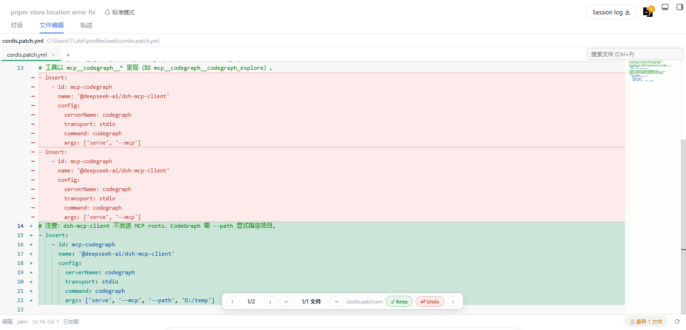
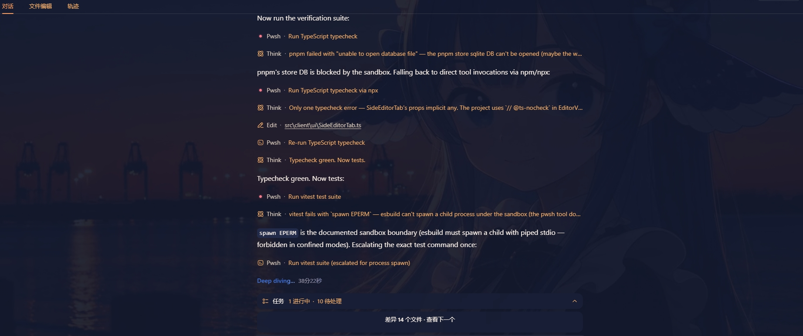
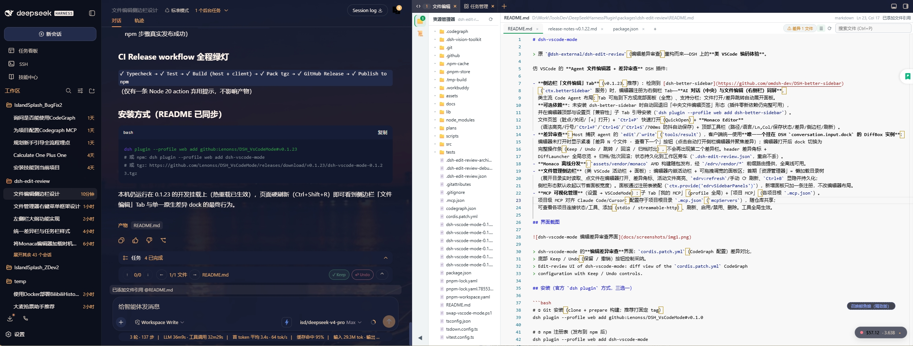

# dsh-vscode-mode

> DSH 上的**类 VSCode 编码体验**：Monaco 文件编辑器 + Agent 差异审查 + LSP 智能。
> 由 `@dsh-external/dsh-edit-review` 重构而来。

- 📝 **同屏编辑**：DSH 0.1.5+ 官方右侧 Sidebar，AI 对话与文件编辑同屏
- 🔍 **差异审查**：Keep / Undo / 回滚 / 归档，状态持久化重启不丢
- 🧠 **LSP 智能**：转到定义 / 查找引用 / Peek 多结果选择 / 智能补全（注释索引）/ 签名帮助
- ⌨️ **命令面板**：`Ctrl+Shift+P`，19 条命令开箱即用，可编程扩展

## 目录

- [特性](#特性)
- [安装](#安装)
- [使用指南](#使用指南)
- [配置](#配置)
- [截图](#截图)
- [开发](#开发)
- [常见问题](#常见问题)
- [更新日志](#更新日志)

## 特性

### 1. 侧边栏文件编辑（推荐形态）

检测到 DSH 0.1.5+ 官方右侧 Sidebar（`ctx.sidebarRightTabs` / `ctx.sidebarRight`）时，
编辑器注册为官方侧边栏 Tab，AI 对话（中央）与文件编辑（右侧）同屏，支持官方
多标签 / 分栏 / 浮出 / 全屏，打开路由即开即展开，官方引导页提供入口。

- **形态优先级**：官方 Sidebar > [dsh-better-sidebar](https://github.com/omdsh-dev/DSH-better-sidebar)
  （桥已归档，仅作旧版回退）> 中央文件编辑页签（零新依赖完整可用）；
  编辑器顶部与设置页「兼容性」子 Tab 给出对应引导。
- **文件链接（DSH 0.1.5+）**：聊天 / 文件树链接经官方 `ctx.sidebarRight.openResource`
  直达右侧栏；「文件链接使用工具」为 自动 / VSCodeMode 时以 extension 档认领
  `dsh-resource://file/**`（Monaco 打开，含行号定位），为「官方侧边栏」档时走
  官方文本查看器；畸形地址自动回落官方查看器。
- **文件页签**：脏点 / 关闭 / 「+」打开 / 右键菜单 / 固定（📌 排最前、隐藏 ×、
  随工作区持久化；**固定 = 保护**，批量关闭永不误关固定页签）。
- **页签数量上限**（通用设置 `maxOpenEditors`，默认 10，**0 = 不限制**）：超限时自动
  关闭**最久未使用**的页签；固定页签与当前活动页签受保护，脏页签在关闭前静默落盘。
- **页签栏滚轮横滚**：页签栏溢出（出现水平滚动条）时，鼠标滚轮（含触控板纵向手势）
  直接横向滚动页签栏；不溢出时不接管，`Shift+滚轮` 沿用浏览器原生横滚。
- **页签右键菜单**（对齐 VS Code）：添加到对话 / 关闭·关闭其他·关闭右侧·关闭已
  保存·全部关闭（`Ctrl+F4` 关当前）/ 复制路径·复制相对路径 / 在文件资源管理器
  （视图）中显示。关闭前未保存页签静默落盘；浏览器无法实现的条目（向右拆分 /
  新窗口）不提供。
- **工作区搜索填充**：编辑器有选中时执行「工作区搜索」（当前键位见官方快捷键目录），
  选中文本自动填入搜索框并立即搜索（多行选区取首行；填入后全选，便于直接改写）。
- **Markdown 预览**（v0.5.3）：打开 `.md` / `.markdown` 后，工具栏「预览」按钮、
  `Ctrl+Shift+V` 或命令栏「切换 Markdown 预览」切入 GFM 渲染（标题/列表/表格/代码块/
  引用/KaTeX），「以源码打开」切回编辑。渲染走官方 `MarkdownText` 原语，零新增依赖、
  自动跟随 DSH 主题；旧版 DSH 缺该原语时降级为纯文本预览。活动文件不是 Markdown 时
  不吞 `Ctrl+Shift+V`（保留「粘贴为纯文本」）。
- **DSH 计划模式接入**：工作区 `plans/`、DSH `.dsh/plans/` 下的 Markdown 计划文件，
  以及成功生成且以 `# 计划：` / `# 计划:` 标题显式关联的 Markdown，默认以预览打开；
  指定行号的链接仍进入源码定位，普通 Markdown 的既有打开方式不变。
  当前会话成功写入/修改计划文件、提交完整计划后自动打开预览；刷新、历史翻页、重连和
  切换会话不会重播旧计划。官方「打开计划」及待审批计划同样转入文件编辑器的只读计划
  页签（最多保留 32 份，退出编辑器后不持久化虚拟正文），不写磁盘、不接入 LSP/SVN/保存；
  审批仍使用对话中的官方控件。打开失败可点击「在官方计划查看器打开」，不影响原审批。
  缺少官方 Sidebar/计划服务的旧版 DSH 保留原查看器；自动生成检测需要 Session 事件源。
- **Monaco Editor**：语法高亮 / 行号 / `Ctrl+F` / `Ctrl+G` / `Ctrl+S` /
  700ms 防抖自动保存；顶部工具栏显示 路径 / 语言 / Ln,Col / 保存状态，提供
  差异 / 侧边栏 / 刷新入口。
- **导航历史**：后退 / 前进跨文件恢复焦点位置（工具栏 `←`/`→`、`Alt+←/→`、
  `Ctrl+Alt+-` / `Ctrl+Shift+-`、鼠标侧键 XButton 均可触发）；后退后新导航
  自动清空前进栈。

### Excel 基础编辑（v0.21.0）

- `.xlsx` 在文件编辑器中打开，支持多工作表、文本/数值/布尔值/日期、基础样式、行高列宽与合并单元格；公式限普通引用及 `SUM` / `AVERAGE` / `MIN` / `MAX` / `COUNT`。
- **只导出副本，不写原件**：使用「基础 · 导出副本」发起浏览器下载；`Ctrl+S`、自动保存和批量关闭均不会将 Excel 当文本写回。下载不表示浏览器已保存成功，也不会清除编辑脏标记。
- 「高级 · Excel / WPS」通过官方 Host 打开原件；未导出编辑不会自动带入高级应用。存在编辑时先询问打开原件、导出或取消。
- 宏格式 `.xlsm`、旧格式 `.xls` / `.xlsb` 不进入基础编辑。含图表、透视表、保护、复杂公式或其他未支持结构的 `.xlsx` 仅提供只读数据预览，禁止编辑和导出；损坏、加密或超预算文件拒绝解析。
- 编辑在当前页面的会话/文件范围保留，切换会话或视图不自动丢弃；关闭脏文件必须明确放弃，外部修改/删除不覆盖编辑。**不承诺刷新、崩溃或 DSH 重启后的恢复**，离开前请导出并确认下载。
- 资源上限：压缩文件 20MiB、单部件解压 32MiB、累计解压 100MiB、50 张工作表、200000 个已用单元格；不支持的导出编辑会报错，而不是静默剥离。

### 2. 命令栏与指令系统（v0.2.0）

`Ctrl+Shift+P`（或 `F1`）唤出 VS Code 式命令面板：输入即过滤（中文 / 分类 /
命令 id 均可命中），`↑↓` 选择、`Enter` 执行、`Esc` 关闭，每行显示 命令名 /
分类 / 当前键位；需要打开文件的命令在空编辑器时自动隐藏。

- **单一数据源**：命令目录（`ui/commandCatalog`）驱动命令栏和官方快捷键目录；
  键位查看/改绑统一走 DSH 官方快捷键配置（设置 → VSCodeMode → 通用 →
  「打开官方快捷键配置」，或 `Ctrl+/`），插件不再自建录键界面，绑定由官方服务持久化。
  旧版 DSH 没有该服务时继续使用原有窗口按键派发，旧 `keybindings` 设置仍可生效。
- **开放注册表**：`window.__edrvCommands__` 暴露 `register()` 注册命令；插件
  不再提供独立的运行时键位注册，改用 DSH 官方 shortcuts 配置。
- **开箱 20 条命令**：保存 / 快速打开 / 在文件浏览器中打开 / 显示所有命令 /
  切换侧边栏 / 工作区搜索 / 切换 Markdown 预览 / 后退·前进 / 上下页签 / 关闭当前页签 /
  上下编辑行 / 转到定义 / 查找引用 / 触发 AI 补全 / 配置代码片段 / 插入代码片段 /
  选中内容加为引用。

### 3. 代码片段（v0.3.0，VS Code 兼容）

支持 `.code-snippets`：`Ctrl+Shift+P` →「代码片段：配置代码片段」打开**居中浮窗**
（现有片段文件列表 + 新建入口），在 Monaco 中按普通文件编辑（JSON 高亮 /
保存即生效 / 支持 `scope` 字段）。

- **两处片段库**：全局 `~/.dsh/snippets/`（所有项目）+ 项目
  `<工作区>/.dsh/snippets/`（随仓库共享）；文件名即生效语言
  （`lua.code-snippets` → 仅 lua，`global.code-snippets` → 全语言），
  新建时可选生效语言。
- **IntelliSense 补全**：编辑 `.lua` 等文件时 `prefix` 自动列出（片段图标 +
  `body` 预览，`Tab` / `Enter` 展开，`$1` / `${2:默认值}` 占位符与 `$TM_*`
  变量可用）；也可「插入代码片段」按语言筛选插入光标处。
- RPC：`snippets.list/read/save/remove/entries`；保存后自动刷新补全缓存。

### 4. 快捷引用（v0.3.0）

选中内容后 `Ctrl+U` 把选中行范围加为**引用**（送入对话上下文，等价 VS Code 的
「Add Selection to Chat」）；无编辑器 / 无选中时该键位不吞键，正常输入不受影响。
（v0.3.1 修复可用性判定：改用与输入实现无关的 `.edrv-editor-row .monaco-editor`
判据，替换被 Monaco EditContext 输入通道取代的 `textarea.inputarea` 探测。）

- **插入点跟随输入框光标**（`caretSpan()`；无光标信息回落文档末尾，选中区域插在
  选区右边界而不替换），修复「连续添加多个引用时既有 chip 被销毁并重复为纯文本」。
- 通道被拒时降级为就地纯文本（保留既有 chip 与正确分隔空格）；两条通道都不可用
  则不写任何内容并提示重试。

### 5. LSP 智能（编辑器内）

`F12` / 右键「转到定义」、`Shift+F12`「查找所有引用」、`Ctrl+点击` 引用导航、
`Ctrl+hover` 可导航标识符下划线提示。v0.4.2 起统一委托完整 Monaco 原生命令：
**多结果弹 Peek 让用户选**，单结果直跳，取不到定义自动降级「转到引用」。

- **智能补全**：输入 `.` / `:` / `(` / `[` 自动弹出候选（`Ctrl+Space` 手动触发）。
  EmmyLua 的注释索引（`---@class` / `---@field` / `---@type`）会被解析为真实的成员列表，
  即对 `---@class` 标注的实例打 `p.` 能列出注解声明的字段/方法；候选项带类型图标、
  弃用标记与片段展开（`${1:占位}`）。文档走 `completionItem/resolve` 惰性拉取，列表响应保持轻量。
- **关键字与注解类型补全**（v0.11.0）：LSP 服务器没有返回候选时补齐 Lua 保留字
  （`local` / `function` …，`luaReservedWords`）；`---@type` / `---@param` 等注释内的基础类型
  （`number` / `string` …）即使在运行中 `quickSuggestions.comments='off'` 也会自动弹出；
  是否请求补全候选按适配器能力位裁决（`completionCap`）。
- **成员回退补全**（v0.11.0）：EmmyLua 没给出成员列表时按当前作用域推导可用成员
  （`memberScope`），补全不再空白。
- **签名帮助**：函数实参处（输入 `(` / `,`）显示参数签名并按当前实参高亮；
  多签名可切换。
- 定义查找带降级链（definition → declaration → 引用推导）；参数 / 局部变量
  （`this`、`pTarget` 这类）同样能跳到声明。
- 相关踩坑与修复见 [常见问题](#常见问题) 第 1–4 条。

### 6. 差异审查（核心能力）

Host 优先采集官方 `workspaceChanges` 的轮次净差异；旧版逐工具记录保留兼容，
同一路径有官方记录时不重复计数。客户端复用现有差异列表、角标和编辑器操作条，
不增加独立审查栏。

- 编辑器未打开 → 差异角标和总览；打开文件后 → 文件内增删区域、↑↓ 定位与
  Keep / Undo。无法唯一映射到当前内容的历史块仍可查看，但不会标在猜测的位置。
- 官方原始摘要及 hunks、审查决定分别保存到插件工作区 SQLite 数据库；跨轮次
  pending 保留。手动保存、文件失配和列表容量限制均不表示已审；旧旁车仅供迁移。
- **Keep** 只改变审查状态，不写文件；支持整条记录或单块处理，尚有 pending 块时
  文件仍在待审列表。文件级动作不暗中处理同路径的其他轮次。
- **Undo** 需要与官方差异一致的独立原始字节证据。写回校验当前内容、文件版本及
  操作日志，保留 BOM、行尾和末尾换行；脏缓冲、版本竞争或内容冲突时拒绝覆盖，
  不把失败当作成功已审。没有受控删除能力的新建文件等场景不强行启用。
- 历史记录不会从当前文件倒推虚构基线；缺证据时仍可看差异和 Keep，但 Undo 禁用
  并说明原因。新证据采集限本会话可观测的 `edit` / `write`，不承诺覆盖 shell、
  外部编辑器或旧 Host 启动前的修改。升级 Host 后需要重启才能启用新回调。

> v0.20.1 已完成重启后真实 GUI 的文件/块级审查与安全拒绝验收。Keep All / Undo All
> 已接入全部分页；批量 Undo 不是跨文件原子事务，遇冲突停止，已完成项不会自动恢复。

### 7. Monaco 离线分发

`assets/vendor/monaco` AMD 构建随包发布，经 `/edrv/vendor/*` 前缀路由全离线可用。
版本锁定 `monaco-editor@0.42.0-dev-20230906`（commit `e7d7a5b0`），用
`node scripts/vendor-monaco.mjs [--force]` 从 npm registry 复现铺入
（版本 + commit 双重断言，防静默换错构建）。

- v0.4.0 起为**官方完整构建**（`referencesController` / `peekView` / `gotoSymbol`
  齐备），修复「查找引用完全没反应」；本地化只保留英文基线 + 简体中文
  （`KEEP_NLS`），`sourceMappingURL` 铺入时剥离（官方指向未分发的 `min-maps/`）；
  构建后 vendor 约 10.3MB（替换前 21.5MB）。

### 8. PDF 浏览与编辑（v0.1.55）

打开 `.pdf` 在编辑区页签内直接浏览（连续滚动 / 翻页 / 缩放 / 文本选择，
cmaps 支持中文渲染）；工具条进入注释编辑：✎ 文本框 / 🖌 画笔 / 🖍 高亮，
`Ctrl+S` 或 💾 保存把批注写回原文件（`pdfDocument.saveDocument()` →
`edrv.saveBinary` base64 回写，工作区边界 + 32MB 上限约束）。

- 引擎离线 vendor 于 `assets/vendor/pdfjs`（build + viewer + cmaps +
  standard_fonts，约 5MB），经 `/edrv/vendor/pdfjs/*` 分发；升级用
  `node scripts/vendor-pdfjs.mjs [版本]`。
- 借鉴开源 [pdf.js](https://github.com/mozilla/pdf.js)（Apache-2.0）。
- **能力边界**：注释级编辑（开源方案不支持无损改写既有正文文字）；加密 PDF
  暂不支持。

### 9. 文件管理侧边栏（类 VSCode 活动栏 + 面板）

编辑器内嵌活动栏 + 可拖拽调宽面板区；首期「资源管理器」= 懒加载目录树
（展开实时读取、点文件打开、差异角标、活动文件高亮、`edrv:refresh` / 手动 ⟳，
可通过命令栏切换显隐并持久化），侧栏形态默认收起以节省面板宽度。

- 拖拽调宽下限 = 最小宽度（默认 300，设置 → VSCodeMode → 通用「编辑器」
  可调 180–560），拖拽低于最小宽度自动收起。
- 面板经注册表装配（`ctx.provide('edrvSidebarPanels')`），新增面板只加一条注册，
  不改编辑器布局。
- **资源管理器右键菜单**（v0.7.0，对齐 CodeBuddy 参考图，区分文件 / 文件夹 / 根空白区）：
  - 文件：打开方式…（已注册打开器中选择）｜ 在文件资源管理器中显示 ｜ 添加引用
    到对话 ｜ 剪切·复制 ｜ 复制路径·复制相对路径 ｜ 重命名…·删除 ｜ SVN 组。
  - 文件夹：新建文件…·新建文件夹（名称支持 `a/b.c` 嵌套）｜ 在文件资源管理器
    中显示 ｜ 添加引用到对话·在文件夹中查找…（搜索面板带目录过滤）｜ 剪切·复制·
    粘贴（剪贴板空时灰显）｜ 复制路径·复制相对路径 ｜ 重命名…·永久删除 ｜ SVN 组。
  - 根空白区 = 文件夹菜单去掉全部「仅非根」项；参考图中本架构无法实现的条目
    （在集成终端中打开 / 运行测试 / Build 等）不显示。
  - 文件管理写操作走 `edrv.fsCreateFile / fsCreateDir / fsRename / fsDelete /
    fsCopy / fsMove`（工作区边界 + 同名拒绝 + 名称校验），删除带确认；重命名 /
    移动 / 删除与开着的页签自动同步（路径改写 / 关签）。剪切·复制·粘贴为应用内
    文件剪贴板（浏览器无系统文件剪贴板，语义对齐 VS Code）。

### 10. 规则管理（v0.1.49 / v0.1.50，参考 Codebuddy）

活动栏「规则」面板，管理 Cursor / Codebuddy 式 `.mdc` 规则文件：「用户规则」
（当前 `DSH_HOME/rules/`，兼容系统用户主目录下的 `~/.dsh/rules/`）与「项目规则」
（`<工作区>/.dsh/rules/`，随仓库共享）双 Tab。`DSH_HOME` 未设置时默认
`~/.dsh`，两个用户目录相同则只读取一次。两处同名规则以当前 `DSH_HOME/rules/`
为准（即使已停用也遮蔽旧规则）；删除当前版本后旧目录版本会重新生效。
新建写当前目录，编辑 / 启停 / 删除旧规则在旧目录原地进行，不自动搬迁；
操作旧规则可能影响其他仍使用该目录的 DSH 安装。

- 每条规则显示 文件名 / 相对路径 / 类型徽标（总是 = `alwaysApply`、自动 =
  `globs`、手动 = 仅索引）/ 描述；右侧常驻 编辑 / 删除 与滑动启用开关
  （只改写 frontmatter `enabled` 行，即时生效无需重启）。
- 新建 / 编辑提供面包屑头部 + 类型下拉与描述 / globs 控件，与原始 `.mdc`
  文本域双向同步（控件改写 frontmatter，文本域回读控件；`enabled` 与其余键
  原样保留）。
- 启用的规则经 host `systemPrompt.section`（order 400）注入每次装配：用户规则
  全局注入，项目规则按会话工作区注入（单条 16KB / 单域 64KB 截断预算；旧版
  DSH 无该服务时自动降级为纯管理 UI）。RPC：`rules.list/read/save/remove/toggle`。

### 11. MCP 可视化管理（设置 → VSCodeMode）

子 Tab「我的 MCP」（profile 全局）+「项目 MCP」（各项目根 `.mcp.json`，
对齐 Claude Code / Cursor，随仓库共享）：支持 stdio / streamable-http 的新增、
刷新、启停、删除和运行状态查看。

- **项目作用域**（v0.13.0）：工具、资源与服务器指令均按 agent 所属工作区隔离；
  跨工作区子会话不会因继承父 scope 而获得外项目 MCP。全局 MCP 保持全局可用。
- **实例与状态**：每个活动 agent、每个启用项目服务各有一个插件实例；没有活动
  agent 时只保存配置（`configured`、实例数 0）。`instanceCount` 是挂载实例数，
  `unverified` 表示没有公开连接状态证据，不能把 fiber ACTIVE 当成已连接。
  零工具可能是合法的纯资源服务器。
- **配置保护**：reconcile 尊重 `disabled`；读取/解析错误保留最后有效连接，
  不把不可读文件当成空配置。保存保留未知字段和未改动的脱敏凭据。

完整配置、迁移与排错见随包 [MCP 技能](skills/dsh-vscodemode-mcp/SKILL.md)。

### 12. 插件自带技能组（v0.3.3）

一组 `SKILL.md` 随包分发并注册进 DSH 技能系统（自定义 skill provider，
`ctx.skills.registerProvider`）——**装了本插件即可用**，无需手工放到
`~/.dsh/skills`。当前收录 **`dsh-vscodemode-mcp`**（MCP 配置与使用指南：
两种作用域 / `.mcp.json` 写法 / `mcp.*` RPC / 命名与冲突 / 工作区隔离 /
故障排查表）。装载状态见 设置 → VSCodeMode →「兼容性」→「插件技能组」；
编辑 SKILL.md 即时生效（fs.watch → invalidate）。

- **命名硬约束**：技能名必须 kebab-case（`/^[a-z0-9]+(?:-[a-z0-9]+)*$/`），
  下划线非法（`@deepseek-ai/dsh-skill` 直接拒绝）；本插件另加前缀白名单
  （不以 `dsh-vscodemode-` 开头跳过并告警，避免污染全局技能命名空间）。
- **frontmatter**：`name`（必填，kebab-case + 前缀）/ `description`（必填，
  模型靠它判断何时加载）/ `whenToUse`（可选）/ `disable-model-invocation`
  （true = 不进模型目录，仅人工显式调用）/ `user-invocable`（false = 禁止
  人工显式调用）；不接受遗留写法 `disableModelInvocation` / `modelInvocable` /
  `userInvocable`。
- **装载与降级**：`ctx.inject(['skills'])` 惰性获取（不写进 `inject` 数组），
  skills 服务缺失时插件其余功能不受影响；服务缺失 / 无 `registerProvider` /
  名冲突 → warn 跳过，不抛错、不影响装配；监听不可用时降级「改动需重载插件」。
- **为什么自研 provider**：开发形态（junction 安装）下官方
  `@deepseek-ai/dsh-skill-filesystem` 按 realpath 解析 import 会
  `ERR_MODULE_NOT_FOUND`（walk 不到 profile 的 node_modules），且每实例会
  多拉 chokidar watcher；自研零新依赖、开发 / 正式形态行为一致、可单测。

### 13. 会话性能管理（设置 → VSCodeMode →「性能优化」）

DSH 启动回放 `~/.dsh/sessions` 全部会话（V8 展开约 10×，可能 OOM）。该子页
提供四项治理手段：

- **盘点**：全工作区会话体积 / 活跃度 / 新旧一览（`edrv.perf.inventory`）。
- **移出归档（可逆）**：巨型 / 旧会话移到 `~/.dsh/sessions-archive`
  （同卷 rename + `.manifest.json`），免重启即从下次启动回放剔除；支持恢复 /
  清除（`movePlan / moveOut / restore / purgeArchive`）。活跃会话一律拒绝移出。
- **压缩调优**：一键把更低 `compaction-basic`（0.6 / 0.12）与 `tool-result-pruner`
  （4096）阈值写入 profile `cordis.patch.yml`（标记块 + 备份 `.bak-<ts>`，可撤销，
  重启生效）；⚠️ 压缩只追加事件、**不重写**已持久化日志——**存量瘦身靠
  「移出到归档」**。
- **会话体积指示器**：对话 header `edrv-perf-size` ≥1MB 显示、≥2MB 琥珀、
  ≥8MB 红，引导「一次任务一个短会话」。
- 治理原则：存量靠归档、增量靠压缩调优 + 短会话习惯 + 体积指示器；packChunks
  （chunk 打包存储）为 DSH 默认开启，无需再配置。

### 14. 外部改动自动同步（即将发布）

磁盘文件被外部改动（其他编辑器 / Unity / 脚本 / agent 工具 / 同步盘）后自动
跟进，不必手点 ⟳：

- **观测**：客户端每 1.5s 把已打开页签路径批量交给 host `edrv.versions`
  （一次请求多条 `fs.stat`，标签页隐藏时整轮跳过），与本地版本基线比对；
  文件树对应目录同步失效，客户端按 `edrv:file-changed` 事件去抖强制重列。
- **判定**：版本变化后**必须再比一次内容**（版本令牌含 `ctime`，格式化工具 /
  同步盘的「同字节重写」也会让它变化）；内容一致 → 只推进基线（不重载）；
  内容不同且缓冲**干净** → 自动刷入并提示「已同步外部修改」；内容不同且有
  未保存编辑 → **绝不覆盖**，编辑区提示条三选一（重新加载 / 覆盖磁盘 /
  保留本地）+ 状态栏「⚠ 外部已修改」；文件被删 → 提示「已被外部删除」，
  缓冲保留。
- **保存护栏**：保存带回上次读取的版本令牌，host 用 `replaceIfVersion` 守卫
  写入——磁盘被外部改过时**拒绝保存**并提示「文件已被外部修改」，由用户显式
  选择重新加载或用编辑器内容覆盖；冲突未处理期间自动保存被抑制。
- 老 host（无该 RPC）自动降级为无同步、无护栏，不报错。

### 15. 系统集成（v0.1.53；v0.13.0 更新打开链路）

设置 → VSCodeMode → 通用 →「系统集成」卡片提供文件管理器右键菜单与 Unity
外部脚本编辑器。两者现在共用按 profile 隔离的本机私有 OPEN 请求/ACK 通道，
无需向 launcher 或 Unity 提供 Host Cookie，也不依赖固定 HTTP 端口。

**① 文件管理器右键菜单**

- Windows 提供文件、目录、目录空白处三类入口；Linux 提供 Nautilus 脚本与
  Dolphin 服务菜单；macOS 提供 Finder Automator 快速操作配方。
- **注册和移除必须由用户在设置页显式操作**。插件 reload/更新只升级已注册的
  launcher 文件及配置，保留所选 profile；不会自动重注册或撤销系统菜单。
  卸载插件前如需清理菜单，请先点「移除注册」。
- Windows 优先使用编译后的 C# launcher，缺少编译器时回退 PowerShell；
  POSIX 使用 Bash launcher。三个入口统一调用随包 `dsh-open.mjs` producer，
  从配置读取所选 profile、私有收件箱和运行程序。
- 已打开的客户端可以领取请求并就地打开。需要唤起时，Desktop 使用官方
  `dsh://open` 入口，Web 使用用户选定的完整应用地址（含实际端口和部署子路径）。
  **唤起窗口或领取请求本身不代表打开成功**。

**打开与回执规则**

| 阶段 | 行为 |
|---|---|
| 投递 | producer 将带请求 id、目标 profile、路径和可选行列的 OPEN 请求写入当前用户私有队列 |
| 领取 | 客户端领取带 lease 的请求，按工作区/会话路由到文件编辑器 |
| 确认 | 只有目标路径对应的实际 Monaco model 或预览内容成功就绪，才提交匹配请求与 lease 的成功 ACK |
| 失败/超时 | 返回失败或未确认；不会把一个已展开的空页签视为成功 |

请求按 profile 与请求身份匹配，队列内容受类型、大小、时效和本机权限检查约束；
producer 只承担「打开」请求，不是通用 RPC 代理。旧 `edrvOpen/edrvPaths` URL
参数仍作为兼容入口保留，已不是 launcher 和 Unity 的当前主链。

文件与目录仍按现有工作区路由：工作区内文件进入相应会话；无会话时可创建会话；
目录根据是否位于已注册工作区内选择复用或新建。选择取消会结束该请求。行列定位
与真正加载的目标文件绑定，避免切换文件时把其他 model 的内容当成完成证据。

**② Unity 外部脚本编辑器（内嵌包 `com.dsh.editor` 0.3.1）**

1. 在设置卡片中选择 Unity 项目，执行安装/更新，将随包 UPM 目录复制到
   `<项目>/Packages/com.dsh.editor`；无需修改项目 manifest。
2. 首次安装会自动准备当前 profile 的独立 bridge，并写入本机项目提示
   `<项目>/UserSettings/dsh-editor.ini`；**无需先注册系统右键菜单**。
3. 在 Unity Preferences → External Tools 选择「DSH 文件编辑」。双击文本脚本、
   Console 报错行列或使用打开项目入口，会通过统一 producer 等待 ACK。
4. Unity 的「DSH 桥接配置」可填写绝对路径覆盖自动选择。优先级为：UI 显式覆盖 →
   项目 UserSettings 提示 → 提示缺失时的旧 shell 配置回退；损坏提示会报错，
   不会静默切换到另一个 profile。

UserSettings 提示包含本机 profile 路径，不适合作为团队共享配置。换机器或切换
profile 后应重新安装/更新桥接，或在 Unity UI 中显式指定对应 bridge 配置。

Unity 包保留文本/代码扩展名白名单与用户自定义扩展；Prefab、场景等资产仍交还
Unity 原生处理，不生成 csproj。Unity API 与 EditorPrefs 在主线程使用；后台任务
负责 producer 与 IO。安装目标已有同名目录但不是本包时拒绝覆盖，卸载仅删除该包目录。

- 管理 RPC：`edrv.integration.status/register/unregister`、`edrv.unity.list/add/remove/install`。
- 保存文件仍遵循当前会话沙箱策略；外部打开成功不扩大文件写入权限。
- 当前验证边界：Windows 官方 Desktop 已完成隔离启动与侧栏挂载等检查；Unity
  仅有 C# 编译桩与 9 项 hint 探针，尚未执行真实 Unity EditMode。Linux/macOS
  尚无本轮现场验证。具体完成项与待验收项见 [0.13 发布说明](docs/release-0.13.0.md)。

### 16. SVN 集成（v0.5.0）

底座是 **svn CLI**（跨平台，自动探测 `svn --version` / 工作副本根），
TortoiseSVN（`TortoiseProc.exe`）仅作 Windows 过渡增强：自研能力覆盖后对应官方项自动隐藏。

- **状态与变更**：侧栏「SVN」面板列出工作副本变更（`svn status --xml --no-ignore`），
  按状态着色与字母徽标、changelist 分组、未版本控制 / 忽略项开关、行内右键动作；
  文件树行尾同步显示状态徽标。
- **动作**：更新、刷新变更、与基线比较、加入版本控制、还原（**破坏性动作均带确认**）、
  清理工作副本（默认只清锁）；未覆盖的项回落 TortoiseSVN。
- **页面内非模态浮窗**（v0.15.4）：SVN 更新、日志、统计、补丁、目录对比及智能整理窗口与文件编辑共用浮窗外壳，可拖动标题栏移动、拖动右下角调整大小、点击置顶；窗口外仍可操作 DSH。文件对比独立浮出，不再替换主编辑区，打开其他文件时保留对比；关闭来源于更新窗口的对比时回到同一更新任务。确认与区间选择仍使用模态弹窗，日志快捷键只在日志窗口内处理。
- **更新窗口**（v0.11.0）：`SVN 更新` 打开插件内窗口——实时逐文件列表与动作着色（A/U/D/G/C/E/R）、
  完成汇总（版本号 / 计数 / 耗时 / 截断告警）、按右键目标限定**路径作用域**（只更新该子目录）、
  命令栏 / 文件树 / 页签 / 编辑区右键四入口一致、可取消；运行中任务按工作副本根**去重**且刷新或
  重开弹窗时**重挂附着**同一任务（不重复启动）；被中断的 svn 操作锁住工作副本时识别
  `E155037` 并给出「执行清理」引导（调 `svn.cleanup`，**不自动重跑更新**）。
- **日志弹窗视觉**（v0.11.0）：信息层级、修订序列签名元素、动作语义色归位重做，
  过滤 / 排序 / 多选 / 键盘 / 右键 / 拖拽行为不变。
- **日志弹窗**（对标 TortoiseSVN Revision Log Dialog）：过滤语法（空格=AND / `-` 排除 /
  `+` 纳入 / `!` 取反 / `"短语"` / 正则）、From-To 日期区间、列头排序 + 复位、
  上中下三段布局（列表 / 提交信息 / 变更路径，边界可拖拽）、Actions 徽标、
  受影响路径灰显或隐藏、Copy from 列、右键菜单、`F5` / `↑↓` 键盘、
  多选（Ctrl / Shift）与「比较两个修订」、**Stop on copy**、**Show Range 区间**、
  **Include merged revisions**（`-g`，合并进来的修订灰字缩进）、
  Show All（上限 5000 条，超出用区间取）、Statistics 统计窗（期间 / 按作者 / 按日期）、
  工作副本版号行加粗。
- **并排差异**：`与上一版本比较`（`cat -r REV` vs `REV-1`）、`比较两个修订`（`-r M:N` 方向按选中顺序）、
  `与工作副本比较`、`某版本 ↔ 工作区`，均复用同一差异视图。
- **诊断日志**：统一日志器 + `edrv.dlog.*` RPC + 命令栏「查看诊断日志」，
  排查白屏 / 加载失败时先看它。
- **RPC**：`svn.status / changes / diffBase / revert / add / log / diffRev / diffPair /
  diffWorking / wcRev / cleanup / update / tortoise`；更新窗口新增 `svn.updateStart /
  updatePoll / updateCancel / updateActive`（`svn.update` 保留兼容）。

> 说明：`plans/`（含对标蓝图与实测结论）为本地开发资料，不入库。

### 17. 断点调试（DAP，开发中）

编辑器内断点调试（DAP 桥通用化：适配器由扩展清单 `contributes.debuggers` 驱动，
不限定语言；Lua 链路复用已装 emmylua 扩展适配器，**零游戏侧改动**）：

- **断点**：编辑器行首点击（或 `F9`）切换断点，红点/灰点（禁用）持久化跨刷新保留；
  鼠标悬停在行首/行号区时显示**半透明预览红点**并切换为手型光标（对齐 VS Code 的 breakpoint hint）；
  侧栏「调试」面板断点列表支持启停复选框 / 删除 / 点击跳转（VS Code 断点视图形态）。
- **断点右键菜单与编辑浮层**（逐条对齐 CodeBuddy / VS Code 内核，文案取自官方中文语言包）：
  空行 → `添加断点` / `添加条件断点...` / `添加记录点...` / `添加触发的断点...`；
  已有断点 → `删除 断点`（`Delete`）/ `编辑 断点…` / `禁用断点`（记录点场景名词自动切换为「记录点」）；
  暂停中额外追加 `运行到行`。「编辑断点…」打开**整宽行内浮层**（View Zone：横跨整个编辑区、
  把下方内容推开，并高亮目标行）：左侧「模式下拉」（`表达式` / `命中次数` / `日志消息` / `等待断点`）+
  右侧**单行输入框**，切换模式时各模式内容独立记忆；`Enter` 确认、`Escape` 取消
  （提示写在输入框占位里）。
- **启动**：编辑区右上浮动工具条选择配置（读取工作区 `.dsh/launch.json`——插件专属文件，
  与 VS Code 的 `.vscode/launch.json` 互不干扰，旧共用文件首次读取时自动迁移过来；类型可用性由
  扩展清单裁决：未发现适配器/入口缺失的类型在下拉置灰并给原因）→ `F5` 启动/继续。
  `emmylua_attach` 按进程名自动附加（复刻 VS Code 扩展的进程枚举语义：窗口标题/进程名包含匹配，
  多候选时工具条切进程选择器明确选择）。
- **命中暂停**：断点命中自动打开对应文件并高亮停帧行；适配器上报 chunkname 由插件工作区
  索引反向映射为工作区文件（`findFileReq` 反向请求应答）。
- **四段调试面板**（活动栏「调试」）：调用堆栈（点击跳转）/ 变量（懒展开树，Variables + ENV）/
  监视（表达式持久化，暂停态求值）/ 断点 + 底部**调试控制台**（REPL 输入表达式即时求值）。
- **实现**：host 半 DAP 桥（`src/dap/*`）spawn 扩展清单声明的 DAP 适配器（`runtime: node`
  跑 js 入口 / 无 runtime 直启原生 exe，清单 `args` 随行），事件经缓冲 + 400ms
  活跃轮询上抛；断点先落 host，适配器就绪（initialized）后全量下发，并按适配器能力位
  发送 `configurationDone` 收尾握手（emmylua 未声明该能力 → 不发，行为不变）。
  `.dsh/launch.json` 配置全量透传给适配器（未识别字段原样保留，`${workspaceFolder}`/`${cwd}`
  已替换；`${command:...}` 为 VS Code 命令占位，启动时明确报错而非假解析）。
  命中行解析用 Monaco 官方 `getTargetAtClientPoint`（手算需扣 `padding-top`，实测易错行）。
- **回执与多线程**：断点回执消费适配器真实响应（可能挪行/判不可验证），未验证断点渲染
  空心红圈（对齐 VS Code）；栈帧 id 用适配器原生值（emmylua 保持栈下标私有语义），
  stopped 事件携带的真实 threadId 贯穿调用栈/单步/暂停（多线程适配器必需，emmylua 恒 1 不变）；
  断点按适配器声明语言过滤下发，杜绝跨语言串发。
- **能力边界**：`emmylua_attach` 仅 Windows（适配器原生限制）；适配器自动探测
  `~/.vscode/extensions`、`~/.vscode-server/extensions` 与插件扩展目录
  `~/.dsh/dsh-vscode-mode/extensions`（与 LSP 探测根一致）；求值/查看变量需处于暂停态。
  `运行到行` = 临时断点 + 继续（命中/手动继续后自动清理，不污染用户断点表）；
  `添加触发的断点...` 当前适配器不支持 → 点击给出明确提示（不做静默失败的假功能）。

### 18. 界面状态记忆（v0.14.0，跨重启）

DSH 每次启动监听随机端口，`http://127.0.0.1:<port>` 就是浏览器 origin，**只写
`localStorage` 的界面状态换一次启动就全丢**。本版把界面状态镜像到 DSH home，重启后
自动恢复。

- **记忆项**：打开的页签与活动页签（含固定态）、每个文件的光标与滚动位置（Monaco
  `saveViewState()`）、侧栏开关/宽度/面板、资源管理器展开与工作区折叠、官方编辑 Tab
  激活态、Markdown 预览态（按文件）、导航历史（前进/后退）、规则分页、搜索面板、
  SVN 过滤与折叠、调试面板监视与折叠、DAP 四段分栏高度、断点（按适配器语言）。
- **存储位置**：`DSH_HOME/dsh-vscode-mode/cache/workspace/<hashOf(cwd)>/ui.v1.json`
  （工作区私有）与 `cache/user/ui-globals.v1.json`（跨工作区共享，如工作区折叠）。
  写前合并，同一文件内多工作区/多键互不覆盖；单键超 64 KB 分片上传。
- **不镜像**：目录条目缓存（`edrv.cache.entries.v2.*`，体积大且可重建）；临时弹窗、
  未落盘的编辑缓冲不恢复。
- **恢复语义**：启动时取回镜像回填 `localStorage`，**本地已有值一律保留**（不覆盖
  当前 origin 的真实状态）；回填完成后广播 `edrv:ui-state-ready`，晚到的界面组件据此
  重跑恢复。取回失败按 8×800ms 有界重试，重试耗尽则退回纯 `localStorage`（行为与
  0.14.0 之前一致），不阻断插件加载、不拖慢启动（slot 注册前最多等 600ms）。
- **自检**：设置页「兼容性」与 RPC `edrv.compat` 可查看运行时报告；镜像读写的时间线记在
  `DSH_HOME/dsh-vscode-mode/logs/debug.<hashOf(cwd)>.log`（无会话期诊断落在
  `debug.<hashOf('ui-state')>.log`）。

## 安装

官方 `dsh plugin` 方式，三选一。下面以 `web` profile 为例；Desktop 或其他命名
profile 请替换为实际目标，不要把示例目录当成当前运行 profile。升级前可阅读
**v0.21.4** 的任务发送结果分类与诚实草稿降级：只有明确 accepted 才等待分析方案；unknown/submitted/cancelled 不另填草稿或重发，安全降级只填实际当前会话草稿并提示手动发送。旧 boolean 接口保留，legacy true 不等于受理。开发 link 客户端 rev458288ddb012 的真实公开入口与目标受理已验；完整 SVN 分析/方案投递因 `SetNamedSecurityInfoW failed (Win32 5)` 未完成，用户仅本批接受此缺口，不代表 Host 整体升级或当前实例已安装 npm 0.21.4。见 [0.21.4 发布说明](docs/release-0.21.4.md)。以下保留历史版本事实：
**v0.21.3** 的 MCP 初始化失败结果与安全收尾解耦：已进入 startup 的调用者在失败或截止时间到达时及时收到拒绝，不再等待旧资源收尾；旧 work/close 未确认完成前仍占冷启动名额、阻止同 key 重建，确认收尾后才开始冷却。首次偶发超时根因仍未知，排队和其他屏障仍可能无界；本版当前 Host/GUI 未部署未验证，用户仅本批接受官方实装隔离模块与 JS 套件替代验收，见 [0.21.3 发布说明](docs/release-0.21.3.md)。官方 bridge 隔离 fixture 同步迁移到当前公开 native 执行器及批调用契约，不代表生产执行器故障修复。以下为历史版本事实，不代表本版现场验收：
**v0.21.2** 的新版 DSH 会话 Controller 与 MCP 公开工具目录适配：任务发送按目标会话持有生命周期，受理不明时不跨通道重发；文件范围引用的剪贴板与降级文本保留行区间；MCP 初始化失败增加脱敏持久化诊断。当前 Web Host 已完成真实 CodeGraph 调用，但首次连接偶发超时根因尚未证实，不宣称已修复，见 [0.21.2 发布说明](docs/release-0.21.2.md)。保留以下历史版本能力与验收边界：
**v0.21.1** 修复缺失历史文件：按完整快照显示整文件删除，Keep 保留删除、Undo 安全恢复快照，预览只读且拒绝覆盖重新出现的文件；真实 GUI 验收缺口已明确保留，见 [0.21.1 发布说明](docs/release-0.21.1.md)。保留 **v0.21.0** 新增 XLSX 基础编辑与浏览器导出副本，原件不自动写回，高级应用通过官方 Host 打开；官方差异定位统一 BOM 与 LF/CRLF/混合行尾口径，并区分内容缺失和多处命中。定位修复不扩展 CRLF patch Undo 能力，目标官方记录 ↑/↓ 的真实点击验收仍保留缺口。保留 **v0.20.5** 跨 DSH 实例只读互通——桌面端与 Web 端各自运行独立宿主时，官方审查列表/详情与工作区只读接口改按持久化会话头的 cwd 解析，另一实例创建的会话也能只读打开官方差异栏，写入类接口仍要求本端活跃会话。保留 **v0.20.4** 统一两套差异栏外观——非官方记录栏角标由内部术语「侧车记录」改为「历史改动」，悬停说明 Keep 只标记已看过、不改写磁盘，Undo 逐项校验后写回，两者都不影响官方审查；官方元数据不可用时给出可读原因与重试按钮，不再静默降级；「会话没在当前端激活」由红色告警改为中性说明。保留 v0.20.3 修复官方差异全部无法定位时差异栏无提示、上下箭头静默禁用（显示「无可跳转」与失效原因，Keep 说明只标记已采纳、不改写磁盘，会话缺失等宿主错误改为可读提示）、v0.20.2 的 MCP 状态告警收敛与原生确认弹窗，以及 v0.20.1 的文件内差异展示、块级/文件级安全审查和跨分页批量操作。升级后重启 DSH 并刷新页面；持久化与回退边界见 [0.20.0 发布说明](docs/release-0.20.0.md)；从 0.14.2 或更旧版本升级还须阅读
[0.14.3 数据迁移与回退说明](docs/release-0.14.3.md)。

```bash
# ① Git 安装（clone + prepare 构建；推荐打固定 tag）
dsh plugin --profile web add github:Lenonss/DSH_VsCodeMode#v0.21.4

# ② npm 注册表（发布到 npm 后）
dsh plugin --profile web add dsh-vscode-mode@0.21.4

# ③ GitHub Release tgz 直装（Release asset 可用后）
dsh plugin --profile web add https://github.com/Lenonss/DSH_VsCodeMode/releases/download/v0.21.4/dsh-vscode-mode-0.21.4.tgz
```

> **DSH 版本政策（0.17.0 起）**：六项 DSH peer 仍统一声明为 `*`，另以
> `engines.dsh: ">=0.1.0-rc.1 <0.3.0-0"` 显式声明支持的 DSH 运行时区间——
> `engines.dsh` 一旦声明就**单独决定**兼容性（官方实现：`An own engines.dsh range
> decides alone and peerDependencies are ignored`），不满足时安装会被直接拒绝。
> 该区间接受 0.1.0-rc.1 起的全部 0.1.x / 0.2.x，拒绝 0.3.0 及以后的主版本；
> DSH 自身以 `includePrerelease` 求值，故 alpha、rc 与正式版同等对待。
> 运行时仍按实际能力检查；允许安装不代表该版本已通过全功能验收。
> 已发布包仍以其实际声明为准；npm 安装前应确认注册表中版本可查询。
> 替换已有包后需重启目标 DSH Host 并强制刷新原页面；仅刷新不会更新 Host。
> 从 0.14.2 或更旧版本升级时，首次访问工作区会执行 0.14.3 引入的 SQLite 活跃记录迁移。
>
> `dsh plugin ...` 是 pnpm 转发器：git 安装会克隆仓库、执行该包 `prepare` 脚本
> （tsdown 双面构建）后安装，再按 `dsh.bundle` 声明自动加入 profile 的 bundles
> 层。若 pnpm 提示构建脚本需批准，把 key 加到
> `~/.dsh/profiles/<profile>/pnpm-workspace.yaml` 的 `allowBuilds` 后重跑。

**安装即生效，无需任何手动配置**：本包自带的 `cordis.patch.yml` 是标准 bundle
自挂载补丁（`- insert: { id: dsh-vscode-mode, name: dsh-vscode-mode }`），加入
bundles 层后重启 DSH 即自动把插件行挂进 loader 树。**不要**再往 profile 用户层
`cordis.patch.yml` 手写 `insert`（旧的非标准做法，会与本 bundle 行撞同一 id，
触发 duplicate loader entry id 启动失败）。

自定义配置（如图标目录 `imageDir`）用 **id 定向覆盖**合并到 bundle 行上，
而不是再 insert 一次：

```yaml
# ~/.dsh/profiles/<profile>/cordis.patch.yml（用户层，应用顺序在 bundle 层之后）
- id: dsh-vscode-mode
  config:
    imageDir: C:/Users/me/Pictures   # 可选，默认读插件包内 assets/
```

> 迁移提示：若你之前按旧版指引在 profile 用户层手写过 `insert`（id 恰为
> `dsh-vscode-mode`），升级后请把那一段 `insert` 改成上面的 id 定向覆盖
> （或直接删除），避免与本 bundle 行重复装配。

- 更新：`dsh plugin --profile web update dsh-vscode-mode`
- 卸载：`dsh plugin --profile web remove dsh-vscode-mode`

## 使用指南

### 打开文件

- **文件树**：资源管理器面板点击打开；**文件链接**（DSH 0.1.5+）：聊天 / 文件树
  里的文件链接直达右侧栏编辑器（含行号定位）。
- **快速打开**：执行插件 QuickOpen 命令（键位见「设置 → 快捷键」）——`↑↓` 选择、
  `Enter` 打开高亮项、`Esc` 关闭，鼠标悬停与高亮同步；`Ctrl+P` 由官方文件切换使用。
- **差异入口**：对话输入框上方 dock 的「差异 N 个文件 · 查看下一个」按钮。

### 快捷键速查

以下是桌面端常见默认键位；Web / Linux 的浏览器或系统保留键可能不绑定。
实际生效键位以 **DSH 官方快捷键配置**为准：设置 → VSCodeMode → 通用 →「打开官方
快捷键配置」（或 `Ctrl+/`）。插件命令与官方命令同表展示、由官方统一校验冲突；
旧版 DSH 无官方 shortcuts 时沿用原有键位。

| 快捷键 | 功能 |
|---|---|
| `Ctrl+Alt+P`（桌面）/ `Ctrl+Alt+Shift+P`（Web Windows/macOS） | 插件快速打开文件（QuickOpen）；`Ctrl+P` 由 DSH 官方文件切换使用 |
| `Ctrl+Shift+P` / `F1` | 命令面板 |
| `Ctrl+U` | 选中内容加为引用（Add Selection to Chat） |
| `Ctrl+S` | 保存（另有 700ms 防抖自动保存） |
| `Ctrl+F` / `Ctrl+G` | 查找 / 跳转行 |
| `F12` / `Shift+F12` | 转到定义 / 查找所有引用 |
| `Ctrl+点击` / `Ctrl+hover` | 引用导航 / 可导航标识符提示 |
| 自定义键位 | 切换文件管理侧边栏（`Ctrl+B` 与 DSH 自身侧栏命令冲突，插件默认不绑定） |
| 以当前官方目录为准（Web 采用平台允许的组合） | 工作区搜索（有选中则填入搜索框）；不保证所有平台都使用 `Ctrl+Shift+F` |
| `Ctrl+Shift+V` | 切换 Markdown 预览（仅活动文件为 .md 时生效） |
| `Ctrl+F4` | 关闭当前页签 |
| `Alt+←` / `Alt+→` | 后退 / 前进（跨文件恢复焦点位置） |
| `Ctrl+Alt+-` / `Ctrl+Shift+-` | 后退 / 前进（同导航历史） |
| 鼠标侧键 XButton | 后退 / 前进 |
| `Tab` / `Enter`（补全中） | 展开代码片段 |
| `F9` | 调试：切换光标行断点 |
| `F5` | 调试：启动 / 继续 |
| `F10` / `F11` / `Shift+F11` | 调试：单步跳过 / 步入 / 步出（暂停态） |
| `Shift+F5` | 调试：停止 |

### 差异审查流程

1. agent 执行 `edit` / `write` 后，对话输入框上方出现差异 dock。
2. 点击「差异 N 个文件 · 查看下一个」打开侧栏编辑器并聚焦差异；编辑器打开后
   dock 变为完整操作条：**Keep**（采纳）/ **Undo**（拒绝）/ 跳转 / 回滚 /
   归档对比。
3. 每条差异处理完成立即归档；DiffLauncher 全局总览支持按批次浏览 + 回滚；
   状态持久化到 `.dsh-edit-review.json`，重启不丢。

### 引用、片段与 LSP

- **快捷引用**：选中内容 `Ctrl+U`（或页签右键 / 文件树右键），插入点跟随输入框
  光标，送入对话上下文。
- **代码片段**：`Ctrl+Shift+P` →「配置代码片段」编辑 `.code-snippets`；编辑代码
  时 `prefix` 自动 IntelliSense 补全，`Tab` / `Enter` 展开。
- **LSP**：`F12` 转到定义（多结果弹 Peek 选择）、`Shift+F12` 查找引用、
  `Ctrl+点击` 导航；取不到定义自动降级「转到引用」。补全随输入 `.` / `:` / `(` / `[`
  自动弹出（`Ctrl+Space` 手动触发，`Tab` / `Enter` 采纳），函数实参处显示签名帮助。

## 配置

键位配置统一走 DSH 官方快捷键：设置 → VSCodeMode → 通用 →「打开官方快捷键配置」
（等价 `Ctrl+/`；官方入口不可用时按钮就地给出手动打开方式）。录键、冲突校验、
按平台默认值、恢复默认都在官方弹窗内完成，插件不再自建录键页面。键位持久化由官方
服务负责（Desktop：`userData/keybindings.json`；Web：`localStorage` 的
`dsh.keybindings.v1`）。旧版插件 `keybindings` 配置的单候选自定义值按当前平台
一次性尝试迁入官方存储；旧配置始终保留供其他平台及人工恢复，多候选、冲突、
不支持或未绑定的旧值不会被部分迁入或删除。

v0.13.0 在 0.12 官方接管的基础上修正真实 `normalized` 绑定与物理 Control/Meta
的转换；首次打开命令面板/QuickOpen 等入口按当前会话 scope 路由，不要求编辑器先挂载。
Web 工作区搜索使用官方当前平台允许的三修饰符组合，最终显示与冲突判断以官方目录为准。
v0.13.1 起插件不再自建录键界面（原独立「快捷键」设置页与共享录制模块已移除），
改由通用页的「打开官方快捷键配置」入口直达官方弹窗。

设置 →「VSCodeMode」页：

| 分区 | 说明 |
|---|---|
| 通用 | 编辑器宽度（180–560）等 / 系统集成卡片 / 文件链接使用工具 / 开发形态开关 / 官方快捷键配置入口 |
| 我的 MCP / 项目 MCP | MCP 服务器可视化管理（stdio / streamable-http） |
| 性能优化 | 会话盘点 / 移出归档 / 压缩调优 / 侧车摘要指引 |
| 兼容性 | 兼容性报告（外部插件探测、路由 / 重复装配护栏）、插件技能组装载状态、旧版形态引导 |

## 截图



> 右侧栏（DSH 0.1.5+ 官方 Sidebar / 旧版 betterSidebar）内的 Monaco 文件编辑器
> 与中央 AI 对话同屏；差异条统一挂在对话输入框上方的原生 dock（编辑器未打开 =
> 「差异 N 个文件 · 查看下一个」，打开后 = 完整 Keep / Undo 操作条）。





## 开发

### 构建（自足，无需 DSH 源码 checkout）

```bash
pnpm install          # 安装 devDeps（typescript/tsdown/@types/node/@types/react/react/vitest）
pnpm build            # tsdown 双面：lib/index.js（host esm）+ lib/client.js（client cjs）
pnpm typecheck        # tsc --noEmit
pnpm test             # vitest 纯函数用例
npm pack              # 产物 tgz（含 lib/assets/src/cordis.patch.yml）
```

`scripts/build.sh` 被 `dev_build_plugin` 等注入工具调用（本地标准构建）。
`prepare` 脚本 = 构建，git 安装 / npm publish 都会自动执行。

### 开发形态（devForm）

开发形态 = 当前运行 profile 以 `link:` 依赖和链接入口指向源码目录。设置 → 通用
可查看和切换形态；切换成功后需要重启 DSH 才能加载新的 Host 代码。

- **定位当前 profile**：优先使用官方 `profileContext.dir`；旧宿主仅在依赖本插件的
  profile 候选唯一时回退。服务信息无效或候选有歧义时拒绝切换，不猜测 `web` 目录。
- **失败恢复**：写入前备份 manifest、lockfile 和原安装入口；安装失败时恢复原内容
  与链接身份。若恢复本身失败，会保留备份位置供处理，不能宣称已经恢复成功。
- **开发目录校验**：要求绝对路径、正确包身份，且不位于被替换的 profile
  `node_modules` 内；移除链接只处理链接本身，不递归删除源码。
- **运行程序**：有官方 `profileContext.packageManager` 时使用它提供的程序、参数和
  显式环境（含 Desktop 自带运行方式）；旧宿主再回退 PATH。

程序化调用继续使用插件已有 RPC，但须经当前已鉴权应用的同源通道；未携带有效
Host 身份的裸 HTTP/curl 请求不再是支持的接入方式。请求地址应保留应用子路径，
Desktop 应沿用当前 `dsh-app:` 应用上下文，不拼接固定 `localhost` 端口。

| 方法 | `args` | 行为 |
|---|---|---|
| `vscode.devFormGet` | `{}` | 读取当前形态，兼容性报告也包含 `devForm` |
| `vscode.devFormSet` | `{ "enabled": true, "path": "<源码绝对路径>" }` | 开启开发形态；按返回的 `restart` 重启 |
| `vscode.devFormSet` | `{ "enabled": false }` | 切回当前插件版本的正式依赖；按返回的 `restart` 重启 |

### 源码结构

```
src/
├── index.ts          Host 入口：name/inject/apply（薄装配，含兼容性报告启动日志）
├── shared/           ★ 双面契约（禁 node/react）：types/rpc/compat/mcp
├── compat.ts         ★ Host 兼容层：外部插件探测、路由/重复装配护栏、兼容性报告
├── devForm.ts        Host 开发形态管理：link:/junction 切换（RPC vscode.devForm*）
├── model.ts          Host 纯域逻辑（可单测）：normalize/markDecision/summary/批次/归档
├── store.ts          Host 存储层：sidecar 读写合并 + 归档持久化 + stale 检测
├── workspace.ts      Host 工作区文件扫描（TTL 缓存）+ 快速打开搜索
├── revert.ts         Host 回滚/删除（fs + subprocess，fs.contains 边界校验）
├── registry.ts       Host 每工作区记录桶注册表
├── tree.ts           Host 目录树纯函数（normalizeRel/toTreeEntries，可单测）
├── rules.ts          Host 规则管理：.mdc 解析/开关改写/注入渲染 + systemPrompt 装配
├── skills.ts         Host 技能组：SKILL.md 解析/扫描 + skill provider 注册（可单测）
├── fileVersions.ts   Host 文件新鲜度观察：批查版本令牌 + 失效目录树索引（可单测）
├── rpc.ts            Host RPC 分发表（类型化 handler 表替代巨型 switch）
├── routes.ts         Host webServer 路由（/edrv/rpc、/edrv/assets/*、/edrv/vendor/*）
└── client/
    ├── index.ts      Client 入口：slot 注册；官方/betterSidebar/中央页签三形态互斥分流
    ├── compat.ts     ★ 设置桥四级降级+晚到重试（configForms→webUiSettings→settingsScope）、slot 安全注册
    ├── officialSidebar.ts ★ 官方右侧 Sidebar 桥（DSH 0.1.5+，唯一维护面）
    ├── sidebarBridge.ts  betterSidebar 桥（归档，仅旧版回退）
    ├── rpc.ts / events.ts / watchDecision.ts（外部改动同步纯逻辑）
    ├── state/        records.ts（摘要/计数/空差异）+ regions.ts（差异区域/行裁剪）
    ├── monaco/       loader.ts（AMD 加载/语言映射）+ diffRender.ts（差异自绘渲染）
    ├── pdf/          pdfLoader.ts + pdfPanel.ts（PDFViewer 接线/注释/保存回写）
    ├── pdfPreview.ts / imagePreview.ts / diffDock.ts（纯函数，可单测）
    ├── sidebar/      ★ 面板系统：registry.ts + SidebarView.ts + panels/（文件树/搜索/规则）
    ├── styles/editor.css  编辑区样式（tsdown CSS-inline 注入）
    └── ui/           EditorView / OfficialSideTab / QuickOpen / DiffBox /
                      ConversationDiffDock / DiffLauncher / DiffBadge / McpSettings
```

随包目录（`package.json` 的 `files`）：`lib/`（构建产物）、`assets/`（Monaco /
pdf.js vendor + 图标 + launcher）、`skills/`（插件技能组）、`src/`（随包发布，
便于阅读实现）、`unity/`（内嵌 UPM 包）、`cordis.patch.yml`。

### 架构要点

- **捕获**：Host 监听 `tools/result`，对 `edit` / `write` 取 `result.value` +
  `result.meta.diffs` 落记录。
- **持久化**：工作区旁车 `.dsh-edit-review.json`（version 2，按 cwd 分桶，写前
  合并，v1 自动迁移）；归档 `.dsh-edit-review-archive.json`（按 path+batch
  合并批次，含每 hunk 决策与 before）。
- **RPC 与资源路由**：`/edrv` 接口先经官方 `connection.requestRejection(req)`
  校验 Host 身份，认证能力缺失时拒绝请求。RPC 校验方法、JSON content-type、
  envelope 和对象参数，同时检查 Content-Length 与实际读取字节上限；响应不缓存。
  Client 按应用 document base 解析 RPC、资源与 vendor URL，保留反向代理子路径，
  支持 HTTP(S) 和 Desktop 的 `dsh-app:` 来源。
- **批次 / 融合 / 归档**：每次新 edit/write 递增文件 batch，早于最新批次的未归档
  差异自动"融合"归档；每条差异处理完成立即单条归档；DiffLauncher「归档」页按
  批次浏览 + 回滚。
- **Client 挂点**：官方右侧 Sidebar Tab（DSH 0.1.5+：类型定义 id `dsh-vscode-mode`、
  kind `edrvEditor`，正文挂 keyed slot `sidebar.right.pane.tab`；优先级最高）>
  betterSidebar Tab `edrv-editor`（归档，仅旧版回退）> `conversation.view` 页签
  （id `edrv-editor`）+ `conversation.session.header.utilities`（id `edrv-diff-badge`）
  + `conversation.input.dock`（id `edrv-diff-dock`，唯一差异栏）。内部路由 / slot /
  事件 / CSS 前缀沿用 `edrv-*`（防回归），包身份 `dsh-vscode-mode`。
- **兼容层**（`src/compat.ts` + `src/client/compat.ts`）：运行时探测
  `@deepseek-ai/dsh-mcp-client`、设置桥（`configForms` 0.1.7+ → `webUiSettings` →
  `settingsScope`，含 15×2s 晚到有界重试）、
  `/edrv` 路由前缀冲突与本插件重复装配（duplicate loader entry）护栏；
  `@deepseek-ai/dsh-settings` / `schemastery` 动态加载（缺失时插件仍可加载，
  设置持久化降级）。「VSCodeMode」设置页 →「兼容性」子 Tab 或 RPC `edrv.compat`
  可查看完整报告。
- **扩展缝**：新能力 = `shared/rpc.ts` 加方法 + `src/rpc.ts` 加 handler +
  `client/` 加组件，其余模块零改动；`monaco/*` 是可复用的编辑器服务（资源树 /
  对比 / 诊断面板共用）；`edrvSidebarPanels` 注册表承载后续面板（搜索 / 差异 /
  时间线），`edrv.listDir` 为通用目录树 API。
- **Host 模块来源**：动态加载优先锚定运行中 DSH 的入口安装树；已解析模块的执行
  错误不会被旧开发依赖副本掩盖。本轮官方 Host 审计与现场基线是 `0.1.7-rc.2`，
  依赖声明、源码能力探测和现场验证是不同层次，详见 [版本适配矩阵](docs/version-adaptation.md)。
- **子进程环境与回收**：LSP/DAP 等共用环境清理，按变量名排除父环境中的
  KEY/PASSWORD/SECRET/TOKEN 与 `DSH_*` 隐式信息；用户显式配置的环境仍会传递。
  Windows 使用进程树终止，POSIX 使用独立进程组；回收是 best effort，不能保证
  清除主动脱离进程组或受系统权限限制的后代进程。
- **代码更新生效**：Host 改动需要重启 DSH；Client 需要重建产物并刷新原应用页面。
  只有对应开发构建 watcher 和 HMR 接收端同时工作时，才可依赖自动更新。

### CI（GitHub Actions）

- `.github/workflows/ci.yml`：push/PR → install → typecheck → test → build →
  `npm pack` 校验 + 上传 tgz。
- `.github/workflows/release.yml`：打 `v*` tag → 同上构建 → GitHub Release
  （附 tgz）→ **若配置了 `NPM_TOKEN` secret** 则同时 `npm publish`（npm 通道）；
  未配 NPM_TOKEN 时仅 GitHub Release 通道，不影响安装。

### 开发期注入（超级模组注入器，可选）

- 热装配：`dev_install_package {dir: packages/dsh-edit-review}`
- 更新：`dev_reload_package {packageName: "dsh-vscode-mode"}`
- 卸载：`dev_uninject_plugin {match: "dsh-vscode-mode"}`（生产环境用
  `dsh plugin remove`）

## 常见问题

**1. LSP 一直显示未启动 / 重启后定义与引用失效（v0.3.4 修复）**

根因：host 侧文档跟踪（tracker）与服务器注册表（manager）是**两套独立结构**——
「重新检测 / 保存配置 / 运行时重装」只摘除 manager 条目、保留 tracker 计数，
此后 `tracker.open()` 对已打开文档恒返回 `false`，该语言**永久不可用直到重启
宿主**。修复三处：① `sync` 在 manager 缺条目时**自愈补建**（计数不重复增，
见 `resolveServer`）；② 重置类操作**同时清 tracker**（`tracker.reset(root,lang)`
与 manager 同范围成对调用）；③ 设置页状态改为**反映真实运行相位**（原先
`edrv.lsp.detect` 硬编码 `idle`，卡片恒显「未启动」）。另收尾宿主退出时残留的
LSP 子进程（原先 `ctx.effect` 清理不覆盖进程退出）。

**2. 引用查找完全没反应，无任何报错（v0.4.0 修复）**

根因：离线 Monaco 是被**裁剪的构建**，缺 `gotoSymbol` / `peekView` 贡献模块，
`editor.action.referenceSearch.trigger` 等动作在运行时不存在，`Ctrl+点击` 与
`Shift+F12` 走原生 Peek 的路径静默失败。修复：换**官方完整构建**（
`referencesController` / `peekView` / `gotoSymbol` 齐备，见[特性 7](#7-monaco-离线分发)），
静默失败同步改为状态栏明确提示。

**3. 差异文件里引用 / 定义 / hover 全空；行内差异标记不显示（v0.4.1 修复）**

根因：**路径形态不一致**——差异记录 `rec.path` 取自工具参数 `file_path`
（**绝对路径**），而 LSP 文档键与 `server.sync()` 拼 `file://` URI 的口径都是
**工作区相对路径**，不归一化时绝对路径会被拼成 `<root>/<root>/Assets/...` 畸形
URI，服务器视其为不存在的文档。实测同一文件：相对路径 `references=3 /
symbols=37`，绝对路径 `0 / 0`。修复：新增 `toWorkspacePath()`（`src/lsp/uri.ts`）
并在 `edrv.lsp.*` **入口统一归一化**（放入口而非 server 内，否则同一文件会因
形态不同产生两条 tracker 记录、引用计数翻倍），`server.sync` 另加防御性兜底。
行内差异标记改为经 `relativeOf` 归一后比较。

**4. Ctrl+点击多结果直接跳走、不给选择（v0.4.2 修复）**

根因：插件**自研的 Ctrl+点击路径**在「0 条其它引用」时降级为「查定义 → 跳
`defs[0]`」，遇到**有多个定义但无其它引用**的标识符（实测 `IsReady` 有 2 个
定义）就硬跳第一个；且与原生 `gotoDefinitionAtPosition` 互相竞争。修复：**统一
委托原生**——`Ctrl+点击` / `F12` / `Shift+F12` 全部走 Monaco 原生命令
（`editor.action.revealDefinition` / `editor.action.referenceSearch.trigger`），
多结果弹 Peek 让用户选，取不到定义按 `alternativeDefinitionCommand` 自动降级
「转到引用」；自研鼠标监听（`bindLspEditor`）与相关死代码已删除。

**5. 冲突差异可看不可点，按钮置灰（v0.4.3 修复）**

根因：pending hunk 的 `newText` 已被后续修改覆盖（定位失败）时 host 标记
`conflict` 并保留供复核，但单文件 Keep / Undo 原先只认「可定位」差异，而全局
Keep All / Undo All 却是亮的。修复：单文件 Keep / Undo 覆盖冲突差异——Keep
记账后归档；Undo 对已不在文件中的差异不改动文件、直接按不采纳归档（状态栏提示
「其中 N 处已不存在于文件，未改动」）。

**6. 快捷引用 / 部分命令被静默隐藏（v0.3.1 修复）**

根因：编辑器可用性探测选择器 `textarea.inputarea` 被 Monaco 的 **EditContext**
输入通道取代（有该 API 的浏览器下 Monaco 不再创建 textarea），导致本命令与其它
12 条 `needsModel` 命令被静默隐藏、按键被放行。修复：改用与输入实现无关的判据
`.edrv-editor-row .monaco-editor`。

**7. 技能被忽略（日志「缺少合法 frontmatter」）**

根因与约定：`skills/` 根目录**不要放裸 `.md` 说明文档**（如 README.md）——扁平
`.md` 会被当作单文件技能解析，缺 frontmatter 时产生告警；约定文档放 `docs/`。
技能名必须 kebab-case + `dsh-vscodemode-` 前缀（下划线非法），frontmatter 用
官方字段名（见[特性 12](#12-插件自带技能组v033)）。

## 更新日志

完整变更见 [GitHub Releases](https://github.com/Lenonss/DSH_VsCodeMode/releases)。
近期关键版本：

- **v0.21.4**：区分任务明确受理、拒绝、不明、仅提交与取消；只有 accepted 开始等待，unknown/submitted/cancelled 不另填草稿、重试或轮询。安全降级只填实际当前会话草稿并提示手动发送，缺详细 API 明确本次未自动发送；旧 boolean 兼容但 true 不等于受理。真实开发客户端公开按钮→目标受理已验，完整 SVN 分析/方案投递因 Win32 5 未验，用户仅本批接受；Host 未重启，不自动部署。见 [发布说明](docs/release-0.21.4.md)。
- **v0.21.3**：MCP 初始化失败时分离调用者结果与安全收尾，已进入 startup 的调用者及时收到失败；旧 work/close 未完成仍占槽并阻止同 key 重建，清理失败不开放替代连接，收尾完成才开始冷却。不宣称解决首次偶发超时、gamma 排队或整体流程有界。当前 Host/GUI 未部署未验证，用户仅本批接受替代验收；不自动部署或重启。见 [发布说明](docs/release-0.21.3.md)。
- **v0.21.2**：适配新版 DSH Session Controller 与 MCP 公开工具目录；固定目标任务发送持有会话直到完成或卸载，受理不明时不跨通道重发。范围文件引用的模型文本、剪贴板与纯文本降级保持一致。MCP 初始化失败记录阶段、耗时和脱敏错误链；迁移官方 native/PTC 执行器集成测试并增加可选真实 CodeGraph stdio 验证。当前 Web Host 真实工具调用已通过，首次连接偶发超时根因仍未证实；不自动部署或重启。见 [发布说明](docs/release-0.21.2.md)。
- **v0.21.1**：缺失历史文件读取完整快照并整文件显示删除行；Keep 保留删除，Undo 安全恢复当前展示快照，不覆盖重新出现的文件。删除预览只读，单文件和批量操作统一处理，记录变化或证据不足时停止。真实 GUI 验收缺口已获用户接受；发布不自动部署，升级后重启 DSH 并刷新页面。见 [发布说明](docs/release-0.21.1.md)。
- **v0.21.0**：新增 XLSX 基础编辑、多工作表与浏览器导出副本，原件不自动写回；不支持结构只读预览，高级应用经官方 Host 打开原件。编辑状态仅在当前页面内保留，不承诺刷新或崩溃恢复。官方差异定位统一 BOM 与 LF/CRLF/混合行尾口径，区分内容缺失与多处命中，保持原始字节及写回校验边界；不扩展 CRLF patch Undo 能力，目标官方记录 ↑/↓ 的真实点击仍未验收。升级后重启 DSH 并刷新页面；发布不自动部署当前实例。
- **v0.20.5**：**跨实例官方审查数据只读互通**——桌面端与 Web 端各自运行独立 DSH 宿主时，会话只存在于创建它的宿主内存里，插件原先一律用本进程的活跃会话解析工作区，另一端打开官方差异栏会拿到「会话不存在」并退化成历史改动栏。现在官方审查列表/详情与工作区只读接口（文件读取、原始字节、分页文本、记录桶、归档列表、目录列表、界面状态镜像）改为按持久化会话头的 cwd 解析：只要会话在共享的 `~/.dsh/sessions` 下留有会话头，其他实例即可只读访问它的官方审查数据；写入类接口（保存、回滚、采纳/拒绝、批量决策）仍要求本端活跃会话，避免两个宿主并发写同一工作区的审查库。已知限制：会话内 `cd` 过的记录只能按创建时的 cwd 冷读；桌面端本版本未重新部署，反向仍不可用。升级后重启 DSH 并刷新页面。
- **v0.20.4**：**两套差异栏不再互相冒充，内部术语退出界面**——插件本来并存官方审查栏与另一条历史记录栏（旧机制把每次改动留痕写进工作区 `.dsh-edit-review.json`），过去两者外观相同、无任何标识，容易被误认为插件未升级。现在非官方栏使用与官方栏同一套版式，但角标改为「历史改动」并在悬浮说明里讲清：这些改动没有进入官方审查列表，Keep 只标记看过、不改文件，Undo 会校验后写回，两者都不影响官方审查；设置页的「侧车摘要」一并对齐为日常说法。官方元数据通道失败（`edrv.review.list` 报错，如 `会话不存在`，或宿主未提供官方文件导航）时，在栏上方给出可读原因与重试按钮，不再静默降级；其中「会话没在当前端激活」由红色告警改为中性说明并存原始详情，真正的磁盘/回滚冲突错误仍保持红色。仅调整展示层，未改动数据库结构、决策语义与回退校验。
- **v0.20.3**：**差异栏失效态可读化**——官方记录的改动已被后续编辑覆盖（当前文件中处处无法唯一定位）时，差异栏位置显示「无可跳转」并说明「本记录 N 处改动均已不在当前文件中」，上下差异箭头补上禁用原因悬浮提示，Keep 提示只标记已采纳、不改写磁盘；「待审」计数与可跳转差异数不再混为一谈，位置显示按块数而非记录数。内容载入期间不再误报失效，同一读取链路成功后自动清除上一次失败提示；`会话不存在` 等宿主错误改为可读说明并指引在其他 DSH 实例继续审查。仅调整展示层，未改动数据库结构、审查决策语义与失效判定。升级后重启 DSH 并刷新页面。
- **v0.20.2**：区分项目 MCP 的等待查询、查询暂停与暂不可用状态；过期观测不再让所有会话显示警告，悬浮详情保留上次观测时间并冻结历史耗时，只有新鲜的初始化错误继续告警。页面恢复可见后串行恢复查询，避免取消中的请求重叠。Keep All / Undo All 改用随 DSH 主题的原生确认弹窗，默认聚焦取消；确认前校验打开弹窗的会话生命周期，取消不执行批量修改。
- **v0.20.1**：恢复官方差异文件内增删、差异导航和块级/文件级 Keep / Undo；Undo 仅在可信原始字节、差异覆盖及文件版本校验通过时写回，无证据或冲突不覆盖。恢复工作区差异文件总数及跨分页、跨轮次 Keep All / Undo All，批量撤销先检查能力、遇冲突停止并报告部分完成。工具栏明确区分全局与当前文件；相同元数据轮询不再重复发布，同文件刷新保留差异直到新详情就绪，消除五秒闪动。升级后需重启 DSH 并刷新页面。
- **v0.20.0**：**官方净差异持久化与现有审查入口整合**——采集官方轮次摘要及差异块，SQLite 保存并保留跨轮次 pending；复用现有列表、角标和文件导航，不新增独立审查栏。支持标记已审和编辑当前文件，保存不自动已审；没有可信历史全文及原始字节时禁止拒绝写回。修复路径身份和冷启动历史补采，无法恢复的旧摘要明确显示缺口；修正浅色主题操作栏文字对比度。详见 [0.20.0 发布说明](docs/release-0.20.0.md)。

- **v0.19.2**：**资源管理器缺失目录自愈**——无可用缓存的子目录返回「目录不存在」时，移除其历史展开记录并经现有防抖持久化，避免红条常驻及跟随刷新重复请求；保留根目录缺失和权限错误，子目录错误显示相对路径。不修改请求 token，确保加载态正常清理，目录重建后可手动展开。有缓存时保持原有降级行为。本次真实 GUI 尚未验收，用户接受该发布缺口；不自动安装或重启当前实例。详见 [0.19.2 发布说明](docs/release-0.19.2.md)。

- **v0.19.1**：**浏览器兼容与编辑器默认值修复**——外部打开与编辑器回执优先使用 `crypto.randomUUID()`，不可用或抛错时回落安全的 `getRandomValues()` UUID；无安全随机源时停用对应能力，不拖垮插件启动。界面状态镜像卸载时清理定时器、存储包装与页面监听，阻止迟到水合回填及卸载后重试。补全 Verilog/SystemVerilog 与 Tcl/FPGA 约束扩展名映射和片段语言目录。焦点与被动编辑器创建时统一读取宿主正文字号，非法或不可用时回退 16px，行高保持原比例；不实时修改已创建实例。已在当前本地 Web 验证受影响入口，真实 pocket/LAN 环境仍未验收。升级须重启 DSH Host 并强制刷新页面；发布不自动安装或重启当前实例。

- **v0.19.0**：**侧栏可靠性与大工作区读取**——扩展面板渲染、图标、可见性及徽标异常隔离；规则与调试面板按需加载并复用根模块单例。目录树采用完整逻辑索引与窗口化 DOM，缓存采用独立 LRU 和不续期的 60 秒硬 TTL，修正不完整持久化快照的命中；修复侧栏拖动清理及 SVN 配对请求过期结果。超出整读限制的文本可显式进入只读 UTF-8 分页，通过官方 `readByteRange/stat` 能力读取，不创建可保存的部分文档；旧宿主能力缺失时明确提示不支持。按需加载要求宿主提供 `require.async`。真实 GUI、HTTP 资源及浏览器滚动验收尚未完成，用户接受该发布缺口；发布不自动安装或重启当前实例。详见 [扩展与读取契约](docs/sidebar-extension-contract.md)。

- **v0.18.0**：**项目 MCP 按需启动与会话状态**——默认按需连接，不再等待服务握手才完成新会话创建；通过 `discover_project_mcp` 获取目录并连接后使用真实工具 schema，保留原工具执行及作用域隔离。支持显式后台预热、逐会话隔离或工作区共享连接（共享服务内部状态须自行确认），冷启动并发上限为 2，共享调用串行、最后租约释放后保温 60 秒。会话列表新增项目 MCP 初始化阶段与耗时详情，状态轮询只读内存，不激活历史会话；初始化完成不代表连接健康已验证。**编辑器**：计划预览页签并入分组页签行，工具固定在行尾，关闭计划恢复先前磁盘页签；单一定义返回前尝试预热目标 Monaco model，减少 Ctrl+hover 定义预览的 `Model not found` 异常。升级须重启 DSH Host 并强制刷新页面；发布本身不更新运行实例。

- **v0.17.0**：**DSH 0.2.1 吸收与运行期优化**——① 修复插件元数据一直失效：`locale/*.json` 改 `{"meta":{...}}` 结构并导出 `./locale/*.json`，插件管理器标题与描述不再回退 `package.json.name`；② 新增 `engines.dsh: ">=0.1.0-rc.1 <0.3.0-0"` 显式声明支持区间（此前仅靠官方 `includePrerelease` 宽容）；③ 跟随会话内 `cd`：13 处 `header.cwd` 直读改走 `workingDirectory` 投影，服务缺失/抛错时回落原始目录；④ 轮询收敛：差异角标 / 输入区 dock / 编辑器 / 体积角标原本各自 5s 拉一次 `edrv.list`，改为会话级共享订阅（单轮询 + 退订到 0 才释放）；⑤ 界面壳层接入 `ctx.locale` 中英双语（slot 名与官方页签标题随语言切换）；⑥ 新增插件管理器详情页「VSCodeMode」状态段。详见 [0.17.0 发布说明](docs/release-0.17.0.md)。
- **v0.16.0**：**C# 智能体体验增强**——C# provider DotRush 优先于 ms-Roslyn（自带 sln 加载与反编译跳转；Roslyn 无 C# Dev Kit 时不加载项目）；csharp 握手后自动找工作区根 `.sln` 发 Roslyn 专有 `solution/open`，元数据符号（Unity 引擎/NuGet 程序集）可跳转与 hover；DAP 调试支持 `runtime='dotnet'` 适配器（DotRush monodbg 形态），按 dll runtimeconfig 要求的运行时大版本选择 dotnet。
- **v0.15.9**：**插件自我更新与可用更新提醒**——设置页「文件与安装」新增更新行：显示当前版本，一键检查 npm 上的最新版本，发现新版后可确认执行自我更新（host 端先卸载再安装插件包，安装失败自动恢复 profile package.json/pnpm-lock.yaml，更新期间页面会短暂断开）。客户端启动后延迟探测新版本，发现可用更新时弹 toast 提醒（每个版本只提醒一次），devForm 开发形态不提醒。详见 [0.15.9 发布说明](docs/release-0.15.9.md)。
- **v0.15.8**：**跨端「会话不存在」兼容**——桌面端与 Web 端各自运行独立 DSH 实例、会话列表互通但会话仅在一端激活时，另一端文件编辑器不再卡在「文件加载失败：会话不存在 0%」：中央区显示「会话在当前端不可用」终态提示（说明成因、保留重试），资源管理器红条同样替换为友好文案。host 三处会话前置错误文案收敛为 shared 常量，client 按常量识别归类。详见 [0.15.8 发布说明](docs/release-0.15.8.md)。
- **v0.15.7**：**Lua 成员链跳转与枚举引用**——规避 EmmyLua 标识符词边界解析问题，从引用结果推导跨文件声明；Lua 表字面量枚举键 Ctrl+点击打开引用 Peek，使用处仍按原生定义跳转。真实 GUI 点击尚未完成验收，用户接受此缺口；发布不自动安装或重启当前实例，详见 [0.15.7 发布说明](docs/release-0.15.7.md)。
- **v0.15.6**：**统一 SVN 项目更新入口**——资源管理器顶部 ↓ 与 SVN 变更页全局 ↓ 均打开插件自带 SVN 更新窗口，目标为当前项目根目录；非 SVN、能力未知或 CLI 不可用时不显示虚假的 SVN 读取提示。保留只读远端检查与本地刷新；本次真实 GUI 未验证，用户已接受此发布缺口，不自动安装或重启，详见 [0.15.6 发布说明](docs/release-0.15.6.md)。

- **v0.15.5**：**浮窗性能与客户端适配**——拖动/缩放改为逐帧直写几何、结束单次提交，多窗口共享视口监听；SVN 日志行表 memo 与选中集优化，冲突状态读取按批 4 并发。LSP 去抖发送前惰性读取全文，隐藏页面心跳目标周期降为 15 秒；兼容性摘要按版本、安装事实与用户选择显示适用诊断，补充搜索刷新回归。保留 0.15.4 全部功能；本次真实 GUI 未重测，用户已接受此发布缺口，未安装/重启当前实例，详见 [0.15.5 发布说明](docs/release-0.15.5.md)。

- **v0.15.4**：**SVN 非模态浮窗与独立文件对比**——更新、日志、统计、补丁、目录对比及智能整理采用与文件编辑相同的页面内浮窗，支持移动、调整尺寸、点击置顶与后台 DSH 交互。文件对比不再占据主编辑区，保留二进制/编码提示和来源任务返回逻辑；确认类弹窗保持模态。真实 GUI 交互尚未验收，用户已接受此发布缺口；资源管理器“目录不存在”原因未定位，本版不宣称修复该提示。

- **v0.15.3**：**搜索结果强制刷新**——目标文件内容被改动后，工作区搜索不再残留过期匹配：内容变更（编辑器保存、外部改动或结构变更）会自动重新执行当前查询，同关键词重搜不再命中 60 秒结果缓存（`edrv.searchContent` 新增 `force` 选项，仅本次调用跳过缓存读取、仍写入新结果）。更新后需重启 DSH Host；真实 GUI 现场重测尚未执行，发布不代表现场验收完成，详见 [0.15.3 发布说明](docs/release-0.15.3.md)。

- **v0.15.2**：**SVN 更新窗口排序与冲突操作**——操作、路径、类型列支持升降序切换；存在冲突时右下角显示跳转按钮，按当前排序循环定位未解决项。冲突项右键提供使用对方/自身完整文件解决、标记解决与还原，操作前确认、操作后重读 SVN 状态；属性与树冲突按实际支持能力提供操作，避免误用文本冲突策略。覆盖排序、DOM 交互与真实 SVN 冲突回归。真实 GUI 尚未验收；发布不代表当前实例已升级。

- **v0.15.0**：**文件页签拖拽与多编辑组**——拖拽重排、跨组移动、四向分屏、页面内可移动浮窗，以及拖入当前 DSH 输入框添加文件引用（不自动发送）。保留编辑缓冲与视图状态，关闭浮窗将文件归回主组；拖拽落点预览跟随主题、25% 不透明度、无描边。保留 v0.14.13 的资源管理器跟随功能，详见 [0.15.0 发布说明](docs/release-0.15.0.md)。

- **v0.14.13**：**资源管理器跟随活动文件**——打开或切换编辑文件时自动展开祖先并滚动定位；资源管理器隐藏期间保留最新活动文件，切回后定位。慢目录加载不再受短重试窗口限制，仅滚动资源树、不抢输入焦点，保留手动定位。用户已确认本地功能验收通过，详见 [0.14.13 发布说明](docs/release-0.14.13.md)。

- **v0.14.12**：**搜索框全选与模糊文件搜索**——工作区搜索打开/再次聚焦时在输入更新后全选旧词或编辑器选区种子，便于直接改写；Ctrl+P 支持大小写不敏感的文件名有序非连续匹配（如 `bn` → `BaseNavigationManager.cs`、`ISTSD` → `ISTaskSystemData.lua`），保留带目录的连续路径查询与 DAP 文件定位规则。更新后需重启 DSH Host；真实 GUI 行为、主题/滚动和 Console 尚未验收，发布不代表现场验收完成。

- **v0.14.11**：**编辑快捷键文案与动作验证**——注释菜单不再写死默认键位，避免自定义绑定后显示误导；明确编辑器本地 Ctrl+D 向下复制、不使用剪贴板；加强原生动作转发与幂等清理断言。默认键位与编辑算法不变，详见 [0.14.11 发布说明](docs/release-0.14.11.md)。
- **v0.14.10**：**简化 DSH 版本政策**——六项 DSH peer 统一为 `*`，取消逐版白名单、上界和仅因版本较新的告警，保留实际能力与冲突诊断；开发依赖固定原版本，避免自动解析漂移。npm 默认预发布语义和验收边界见 [0.14.10 发布说明](docs/release-0.14.10.md)。
- **v0.14.9**：**编辑快捷键与桌面安全刷新**——`Ctrl+/` 保留官方快捷键入口，行注释改为 `Ctrl+Alt+/`（Web Linux 默认不绑定）；编辑器本地 `Ctrl+D` 调用 Monaco 原生向下复制行，块注释不变。桌面 `Ctrl+Shift+R` 刷新当前界面、不重启 Host；未保存代码/PDF、待保存、保存中或外部冲突时拒绝刷新，界面状态镜像失败/超时也不刷新。真实 GUI 按键和状态恢复尚未验收，详见 [0.14.9 发布说明](docs/release-0.14.9.md)。
- **v0.14.8**：**Unity 打开目标选择与桌面端打开修复**——Unity 外部脚本编辑器 `com.dsh.editor` 0.3.1 新增「打开目标」选择（自动/DSH Web/DSH 桌面端），桌面端按 profile bridge 定位、缺失明确报错；桌面 profile 开机自动准备独立 bridge，无需先注册 OS 菜单。修复桌面端 sessions 服务面缺 `.open`/`.create` 导致的「编辑器打开失败或取消」（改走 `materializeScope → manager.select` 多面切换与 `newDraftSession` 回落）。验证范围与真实 GUI 验收缺口见 [0.14.8 发布说明](docs/release-0.14.8.md)。
- **v0.14.7**：**SVN 资源管理器状态图标与编辑过程自抵消自动归档**——文件树叠加 SVN 状态图标（含目录子树聚合、远程状态、冲突/缺失等标记与矢量叠加），有界快照单飞投影、流式状态解析与写操作后定向刷新；新增后再还原的编辑过程自抵消记录自动归档跳过审查，先保存再独立归档、事务失败回滚内存标志。修复 DAP 帧源码路径按语言过滤候选、不回落错误语言文件；刷新事件携带 scope/paths 细化。验证范围与真实 GUI 验收缺口见 [0.14.7 发布说明](docs/release-0.14.7.md)。
- **v0.14.6**：**对话切换位置保持与共享查找**——同工作区切换对话时，在编辑器释放前保存实际模型的滚动、光标和选区等视图状态；只在模型重新绑定时恢复，显式行号导航仍优先。跨文件共享 Ctrl+F 查询、大小写/全词/正则与开关状态，不共享选区搜索范围或匹配序号，不抢焦点；工作区隔离并释放监听。验证范围与真实 GUI 验收缺口见 [0.14.6 发布说明](docs/release-0.14.6.md)。
- **v0.14.5**：**计划模式接入与行内差异显示修复**——计划文件默认预览，当前会话新生成计划自动打开；官方计划及待审批计划可转入只读虚拟页签，审批仍由官方控件完成。行内增删与 Monaco diff 共用明暗色盘，删除代码按当前语言着色，旧行号仅在快照可验证时显示；修复纯删除的 BOM/CRLF 定位，清理过期异步结果与监听。验证及真实 GUI 冒烟边界见 [0.14.5 发布说明](docs/release-0.14.5.md)。
- **v0.14.4**：**Desktop rc.2 兼容与 MCP 管理修复**——六项 DSH peer 精确纳入 `0.2.0-rc.2`；MCP 状态不再把配置启用或 ACTIVE 当成在线证据，只读快照轮询避免重复配置扫描，配置修改串行防止丢更新，跨全局/项目拒绝工具命名空间交叠并安全隐藏历史歧义工具。编辑器在没有待处理差异时隐藏底部操作条，其他文件的差异和冲突入口保留。验证范围、升级及回退注意事项见 [0.14.4 发布说明](docs/release-0.14.4.md)。
- **v0.14.3**：**差异审查性能与持久化**——差异定位/行号与多块应用避免重复全文扫描/复制；归档从全量 JSON 改为每工作区 SQLite 事务追加，活跃记录由整份重写改为逐条更新，同库原子提交决策及 Undo 意图；归档列表按页加载、详情按批次读取。Web 实测单块 Keep RPC 17/22ms（样本值），旧归档 JSON 与迁移前活跃 JSON 保留；侧栏编辑器内的差异栏改为居中悬浮 banner。升级和回退注意事项见 [0.14.3 发布说明](docs/release-0.14.3.md)。
- **v0.14.2**：**全局搜索选项行为修复**——未勾选「区分大小写」时显式使用内容搜索 `--ignore-case`，大写查询仍命中小写内容，不改变文件 glob 的大小写规则；「仅当前文件」无活动文件时不再误搜整个工作区，切换活动文件时自动重搜。大小写、全词、正则与包含/排除开关补充定向测试；详见 [0.14.2 发布说明](docs/release-0.14.2.md)。
- **v0.14.1**：**DSH Web 0.2.0-rc.1 安装兼容**——六项 DSH peer 精确加入
  `=0.2.0-rc.1`，保留已有 0.1.x 范围，继续拒绝其他未经适配的 0.2 版本；
  版本线报告单列 rc.1。已完成 Web 安装、挂载与编辑器基础冒烟，完整功能和
  Desktop 等其他平台尚未逐项验收。详见 [0.14.1 适配与发布说明](docs/release-0.14.1.md)。
- **v0.14.0**：**界面状态跨 DSH 重启恢复**——DSH 每次启动端口随机，origin 一变
  `localStorage` 就换了一份空的，插件的页签、光标、侧栏、编辑 Tab 等全部界面状态都
  随之丢失。本版把界面状态镜像到 DSH home（`cache/workspace/<hash>/ui.v1.json` 与
  `cache/user/ui-globals.v1.json`，写前合并），新增 RPC `edrv.uiState.get/set`，客户端
  包装 `localStorage` 写口去抖推送、启动回填并广播 `edrv:ui-state-ready`；同时补上
  官方编辑 Tab 激活态、Markdown 预览态与导航历史三项记忆。发布前两轮现场复盘修掉两个
  并存根因：水合冷启动失败即永久放弃（现为 8×800ms 有界重试 + 重试耗尽也广播就绪）、
  界面在回填前写空初值把存档覆盖掉（现为「水合结束前不写存档 + 迟到回填后重跑恢复」）。
  详见 [0.14.0 发布说明](docs/release-0.14.0.md)。
- **v0.13.1**：**快捷键入口收敛到官方弹窗**——移除插件自建的独立「快捷键」设置页
  （含行内录键编辑器与共享录制模块 `shortcutRecorder.ts`），改在 VSCodeMode → 通用页
  提供「打开官方快捷键配置」一键跳转（`openOfficialShortcuts()`；官方入口不可用时
  就地给出手动打开方式）。键位查看、录键、冲突校验与恢复默认全部由 DSH 官方弹窗承担，
  避免同一套录键逻辑两处维护；0.13.0 的绑定转换修复与 Web 三修饰符默认值不变。
- **v0.13.0**：**Host 鉴权与 Desktop 适配、项目 MCP 三面隔离、外部打开回执**——
  `/edrv` 路由接入官方认证与有界请求体读取，URL 保留应用子路径并支持 `dsh-app:`；
  项目 MCP 改为每 agent 挂载，隔离工具/资源/指令，新增配置态、未验证状态与实例数；
  开发形态切换使用实际 `profileContext` 并支持失败恢复；子进程环境清理与进程树
  回收收敛；在 **0.12 已有官方快捷键接管**上修复 normalized 绑定、录制收尾及
  按会话 scope 首开。C#/PowerShell/Bash launcher 与 Unity 0.3.1 共用私有
  OPEN/lease ACK 链路，真正加载目标 model/预览后才确认；Unity 首装自动配置
  profile bridge，无需注册 OS 菜单；外部工具面板可选打开目标（自动/DSH Web/DSH
   桌面端），桌面 profile 开机自动准备独立 bridge。迁移、部署、回滚和验证边界见
  [0.13.0 发布说明](docs/release-0.13.0.md)。
- **v0.12.0**：**用户规则双目录兼容 + 官方快捷键接管**——用户规则同时读取
  `DSH_HOME/rules/` 和 `~/.dsh/rules/`，同名以当前目录为准，旧规则原地管理，
  列表与提示词注入采用同一优先级；快捷键迁移到 DSH 官方 shortcuts 目录及独立设置页，
  支持跨平台默认键位、录制、冲突校验和旧配置迁移；插件 QuickOpen 改用
  桌面 `Ctrl+Alt+P` / Web Windows/macOS `Ctrl+Alt+Shift+P`（官方占用 `Ctrl+P`）。恢复插件键位只处理插件命令，
  旧键位配置为跨平台回退始终保留，多候选不做部分导入；没有官方服务的旧版 DSH
  仍使用原有键位派发。
- **v0.11.0**：**原生 SVN 更新窗口（逐文件实时反馈）+ LSP 补全增强 + 设置文件就地打开**——① 「SVN 更新」
  从窄结果条升级为**插件内更新窗口**（`SvnUpdateDialog` + `svnUpdateJob`）：任务启动窗口即出现，实时
  逐文件列表（虚拟化 + 仅贴近底部时自动跟随）、动作着色（A/U/D/G/C/E/R）、完成后汇总版本号 / 计数 /
  耗时 / 截断告警；命令栏、文件树、页签、Monaco 右键四个入口一致，并按右键目标做**路径作用域**
  （只更新该子目录）；② 运行中任务按工作副本根去重、可**重挂附着**（刷新或重开弹窗接续同一任务，
  不重复启动），取消走 `svn.updateCancel`；被中断的 svn 操作会锁住工作副本——失败终态识别
  `E155037` 并给出**橙字锁定提示 + 「执行清理」按钮**（确认后调 `svn.cleanup`，绝不自动重跑更新）；
  ③ 新增 RPC `svn.updateStart / updatePoll / updateCancel / updateActive`（保留 `svn.update` 兼容），
  宿主先以只读 `svn --version --quiet` 探测通过才真启动，输出按行分页并有界缓存；
  ④ **LSP 补全增强**：补齐 Lua 保留字与 `---@type` 注解基础类型补全（运行中
  `quickSuggestions.comments` 为 `off` 时也能自动弹出）、Emmylua 成员列表的**回退补全**
  （注解缺失时给可用成员），并按适配器能力位决定是否请求补全候选；
  ⑤ **设置配置文件就地打开**：设置页「打开配置文件」不再调系统文本编辑器，改由插件从 host
  settings service 取文档路径、经插件 RPC 路由到内置编辑器；
  ⑥ **SVN 日志弹窗视觉重做**（信息层级、修订序列签名元素、动作语义色归位；过滤/排序/多选/键盘/
  右键/拖拽行为不变）。
- **v0.10.0**：**SVN AI 深度分析发送链路重构**——① 发送主路径切换为**官方 composer
  链路**（`inputFor` setDraft + submit，即 UI「发送」内部路径，带 scope 铸造时延 3 次
  重试），`remote.session` 具名槽 RPC（`{args:{request:{rpcId,payload}}}`，gateway
  `invoke` 铁证形态）多形态容错为兜底、HTTP wire 直调降为最后兜底；② 新会话创建
  主路径改为 **client store manager 面**（`sessions.create`，官方 connectWorkspace
  同链路，create 自带 store upsert → `open` 切换可用），wire 直调虽能建会话但 store
  无感故只作兜底；③ 新会话**主动铸造 scope + 命名「AI 深度分析 · \<目录\>」**
  （`materializeScope` + `manager.rename`），会话列表一眼可见、点击即入；
  ④ SvnPanel 通知文案同步更新，34 个 svnAiPlan 用例对齐新形态。
- **v0.9.0**：**远端工作区差异审查（issue #7）+ SVN 变更 AI 智能分组**——① 支持
  ssh remote 插件打开的**远端项目**做交互式差异审查：按工作区根 `.remote-ssh.json`
  识别镜像根（向上 ≤8 层，与官方 findMirrorRoot 同判据），agent 写远端后以 `node:fs`
  **写穿本机镜像**（不走 ctx.fs 写桥，避免相同内容再推回远端的重复 SSH 往返），
  展示/决策链路对齐本地工作区；② **SVN 变更列表 AI 智能分组**：AI 对变更文件自动
  分组归类 + 方案弹窗（`SvnAiPlanDialog`）、单组条目预算防超长（`svnListBudget`）、
  对话内变更自动分组入列（`svnTriage`），SvnPanel/状态链路与徽标同步增强；
  ③ **适配 DSH 0.1.7-alpha.2**：Config 全字段 `.volatile()`（否则设置页 entry 不下发、
  写入抛 `has no volatile fields`）+ `@deepseek-ai/schemastery` 移入 dependencies 钉
  `~3.18.4` + 配置读点解引用 volatile 引用 + 兼容页「Config volatile 字段」行与告警；
  ④ **修复 Ctrl+点击首开不定位（第三次回归）**：根因=并行改码触发 client HMR 热重载、
  EditorView 重挂载销毁挂载级 pendingFocus → 新增 `window.__edrvPendingNav__`
  跨挂载交接槽（TTL 30s、落点才清）+ 落点前模型身份守卫；首开/交接注入/同文件/
  搜索入口四轮现场复测通过。
- **v0.8.0**：**DSH 0.1.7 兼容适配 + 文件树原生打开**——P0×3 修复（0.1.7 移除
  `settingsScope` 致整客户端停等 → 设置桥四级探测 + 15×2s 晚到重试；`installSection`
  移除 → `forms` 策略 + `export const Config` 与 section schema 同源；0.1.7 图标改名
  `Icon<Name>16→Regular` 致侧栏图标全灭 → `icons.ts` 跨版本出口 + 占位兜底）；新能力：
  文件树原生打开（`nativeOpenExts` 可配置范围，默认=让位清单，claim `canOpen` 同步让位）、
  插件管理页 icon + `locale/` 双语声明、图片缩放（适应宽度默认/±10%/每页签记忆）与
  PDF 百分比指示、perf 面板官方归档/置顶徽标、`edrv.readBinary` 二进制预览通道
  （octet-stream + base64 自动回退）。设置体系迁移：settings.yaml 一次性导入 profile
  Config，读写统一 `sectionOf/updateSection`（冲突重读重试）。
- **v0.7.0**：**资源管理器右键菜单**——区分文件 / 文件夹 / 根空白区三套菜单：打开方式…
  （已注册打开器选择）、在文件资源管理器中显示、添加引用到对话、新建文件/文件夹
  （支持 `a/b.c` 嵌套）、在文件夹中查找（搜索面板目录过滤）、剪切·复制·粘贴（应用内
  文件剪贴板，语义对齐 VS Code）、复制路径/相对路径、重命名/删除/移动（写操作走
  `edrv.fs*` 边界校验，删除带确认，与开着页签自动同步）、SVN 组。
- **v0.6.0**：**编辑器内断点调试（DAP）+ SVN 补丁/汇总/导出**——① DAP 桥通用化
  （适配器由扩展清单 `contributes.debuggers` 驱动，Lua 链路复用 emmylua 适配器、零游戏侧
  改动）：行首点击/`F9` 断点（悬停预览红点、禁用灰点、跨刷新持久化）、断点右键菜单与
  **整宽行内编辑浮层**（表达式/命中次数/日志消息/等待断点，模式内容独立记忆）、
  `.dsh/launch.json` 启动配置（`F5` 启动/继续、`emmylua_attach` 按进程名自动附加与多候选
  选择）、命中暂停跳转（chunkname 反向映射工作区文件）、活动栏**四段调试面板**
  （调用堆栈/变量/监视/断点 + 调试控制台 REPL）；② SVN 增强：补丁对话框、汇总对话框、
  导出（`svnExport`）。
- **v0.5.3**：**编辑器四项体验增强**——① `Ctrl+Shift+F` 时编辑器有选中则把选中文本
  自动填入搜索框并立即搜索（多行选区取首行；侧栏原本收起也生效）；② 页签数量上限
  （通用设置 `maxOpenEditors`，默认 10，**0 = 不限制**），超限自动关闭**最久未使用**的
  页签，固定页签与活动页签受保护、脏页签关闭前静默落盘；③ 页签栏溢出时鼠标滚轮即可
  横向滚动（`Shift+滚轮` 沿用浏览器原生横滚，不溢出时不接管）；④ **Markdown 预览**：
  `.md` / `.markdown` 经工具栏按钮、`Ctrl+Shift+V` 或命令栏切换 GFM 渲染（标题/列表/
  表格/代码块/KaTeX），复用官方 `MarkdownText` 原语，零新增依赖、自动跟随 DSH 主题。
- **v0.5.2**：**修复 macOS / npm 安装形态的兼容问题**——① schema 库按候选链解析
  （官方已把 vendored schemastery 改名为 `@deepseek-ai/schemastery`，安装树里没有裸
  `schemastery`），且 `@deepseek-ai/dsh-settings` 缺失不再拖垮整体 → 修复从 npm 安装时
  「设置 section 尚未装配 / 设置持久化未安装」（开发形态因有 devDependency 副本而不复现）；
  ② VSIX 解包保留归档自带 Unix 执行位并按入口名兜底补 0o755 → 修复 macOS/Linux 上语言
  服务器 spawn `EACCES` 起不来；③ 删除新建文件按平台分派删除命令（macOS/Linux 不再先试
  PowerShell 再回落）。
- **v0.5.1**：**适配 DSH 0.1.6-alpha.2**——会话作用域三级取值链（`uiSession.current`
  优先，兼容旧版 `sessions.list.current`；修复官方移除 `current` 后 Monaco 预热 / LSP
  同步 / 编辑 Tab 恢复 / 文件链接静默失效）；Office 与官方「不可预览」后缀让位官方
  查看器；页签路径统一为工作区相对路径（差异栏跳转与资源管理器显示形态一致，并修复
  连带的「在资源管理器视图中显示」失效与重复页签）；插件重载时注销 Monaco provider
  防止重复注册；peer 依赖清理与预发布区间修正。
- **v0.5.0**：**SVN 集成**——侧栏变更面板与状态徽标、自研日志弹窗（过滤 / 排序 /
  多选比较 / 区间 / Stop on copy / Include merged revisions / Statistics）、
  并排差异（基线 / 版本间 / 与工作副本）、诊断日志查看器。
- **v0.4.x**：LSP 与 Monaco 系列修复（见[常见问题](#常见问题)）；外部改动自动
  同步即将发布。
- **v0.3.x**：命令栏（v0.2.0）→ 代码片段 / 快捷引用（v0.3.0）→ 插件技能组
  （v0.3.3）。
- **v0.1.5x**：官方侧边栏形态（v0.1.60 推荐）、PDF 浏览编辑（v0.1.55）、
  系统集成（v0.1.53）、规则管理（v0.1.49 / 50）。
